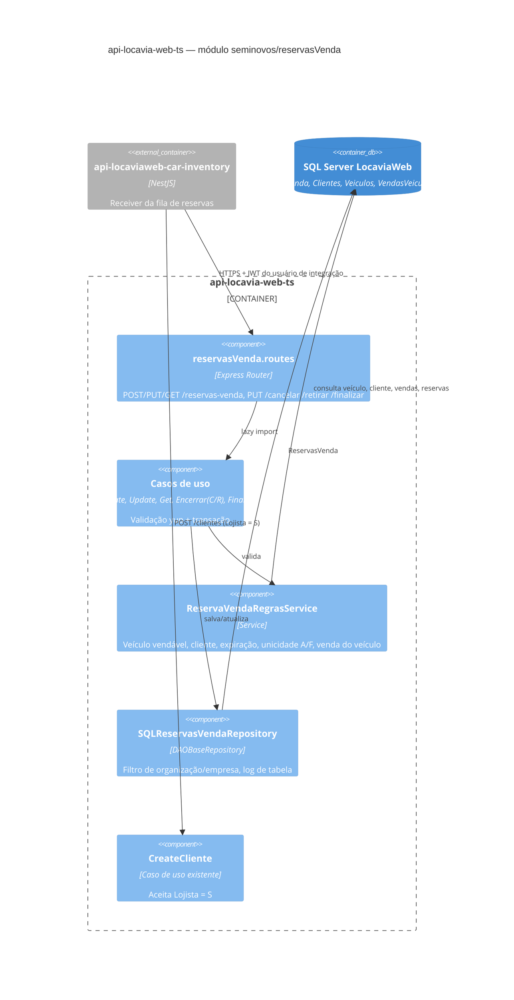
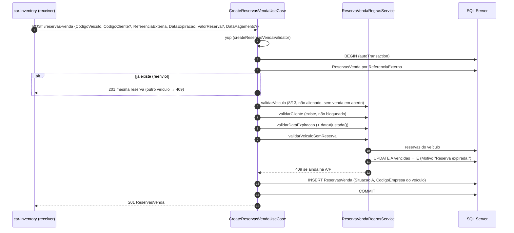
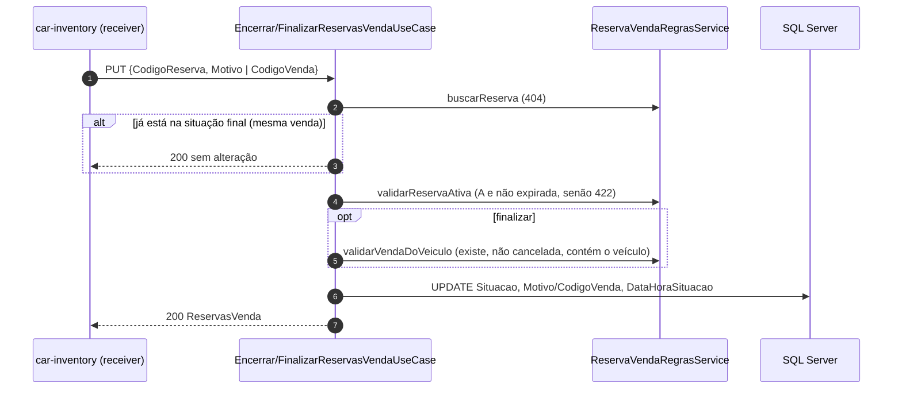
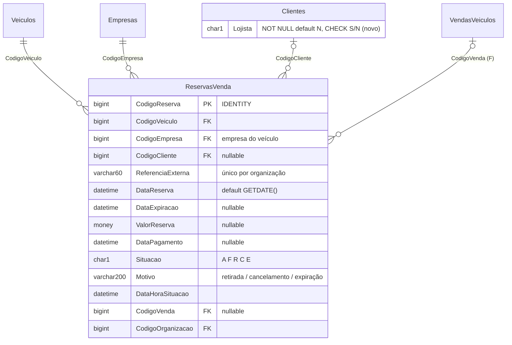

> Módulo novo no padrão de `cadastros/veiculosRestricoes` e `faturamento/modeloEmailNotaFiscalServicoEletronica`: Express, TypeORM, migrations idempotentes e testes Vitest com fábricas de SUT.

# 01 — Documento de Design: Reserva de venda (`reserva-venda`) no Locavia

## 1. Considerações

#### 1.1 Premissas

- O Locavia é o **sistema de registro** da reserva de venda. Ele guarda a reserva e aplica as regras de negócio. A integração `api-locaviaweb-car-inventory` só chama os endpoints dele e nunca grava direto no banco.
- A reserva nasce no Só Estoque. Todas as escritas chegam pela integração, autenticada pelo usuário de integração (`POST /sessoes`).
- Situações (decididas em 2026-11-10):

  | Situação | Letra | Bloqueia o veículo? | Origem |
  | --- | --- | --- | --- |
  | Ativa | `A` | Sim, até a `DataExpiracao` | Inclusão |
  | Finalizada | `F` | Sim | Venda do veículo (`CodigoVenda`) |
  | Retirada | `R` | Não | Lojista retira a reserva, com motivo |
  | Cancelada | `C` | Não | Cancelamento, com motivo |
  | Expirada | `E` | Não | Reserva ativa vencida |

- **Regra de unicidade:** um veículo pode ter várias reservas, mas no máximo uma `A` (não expirada) ou uma `F`. As demais ficam `R`, `C` ou `E`.
- **Expiração sem rotina agendada:** uma reserva `A` vencida deixa de bloquear o veículo. Ela é gravada como `E` quando chega uma nova reserva do mesmo veículo. Antes disso, o leitor deduz a expiração comparando a `DataExpiracao` com a hora do banco.
- **Lojista:** quando o cliente da reserva não existe no Locavia, a integração o cadastra pelo `POST /clientes` com `Lojista = 'S'`. Um cliente que já existe não é alterado.
- **A validar com o produto:**
  - Uma reserva `F` cuja venda for cancelada ou devolvida continua bloqueando o veículo. Hoje nada a reabre (ver 2.5, riscos).
  - Hoje o `CreateVendasVeiculos` do Locavia **não** recusa um veículo com reserva ativa. Essa checagem é feita só pela integração.

#### 1.2 Restrições

- **Datas:** seguem o padrão do Locavia, a hora de Brasília do banco rotulada como `Z` (`dataAjustada()`), sem conversão de fuso.
- **Erros:** no padrão `{ status, statusCode, data, erros: [{ message }] }`. As exceções tipadas (`NotFound` 404, `Conflict` 409, `UnprocessableEntity` 422) recebem só a mensagem, de `ReservaVendaMensagemConstant`, sem código. A integração trata qualquer 4xx como recusa de negócio terminal.
- **Transações e consultas:** toda escrita roda em `TransactionManager().autoTransaction`, com as consultas em sequência. Um `Promise.all` dentro da transação gera `EREQINPROG`.
- **Tabelas existentes:** o veículo, a venda e o cliente não são alterados pela reserva. O status do veículo continua 8/13 durante a reserva.

#### 1.3 Ambiente do Sistema

- Node.js, Express 5 e TypeORM 0.3 sobre SQL Server (banco único multi-organização, filtrado por `CodigoOrganizacao`), mesmo processo e deploy do `api-locavia-web-ts`.
- Rotas descobertas automaticamente (`*.routes.ts`).
- Migrations executadas no boot (`runMigrations`).
- Não há infraestrutura nova.

## 2. Arquitetura

#### 2.1 Visão Geral

**Escopo:**

- Tabela `ReservasVenda`.
- Coluna `Clientes.Lojista`.
- Módulo `src/modules/seminovos/reservasVenda` com os casos de uso Create, Update, Get, Cancelar, Retirar e Finalizar, as regras em `ReservaVendaRegrasService` e o Swagger.

**Cadeia de chamada:** Só Estoque → `api-locaviaweb-car-inventory` (fila e receiver) → `POST/PUT /reservas-venda` → `ReservaVendaRegrasService` → `SQLReservasVendaRepository` → `ReservasVenda`.

| Decisão | Motivo |
| --- | --- |
| Rotas `POST`, `PUT` e `GET /reservas-venda`, mais `PUT /cancelar`, `/retirar` e `/finalizar` | Segue o padrão do Locavia, sem `/:id` e com o código no corpo ou na query. Mudar a situação com motivo é uma ação de negócio, não um update genérico. |
| Não há `DELETE` | A reserva é histórico comercial. Cancelar ou retirar faz o papel da exclusão sem apagar o rastro. |
| `ReferenciaExterna` única por organização (índice filtrado) e Create idempotente | Um reenvio da fila (SQS) devolve a mesma reserva. Uma referência já usada em outro veículo responde 409. |
| Cancelar, retirar e finalizar idempotentes | A reserva que já está na situação final é devolvida sem alteração, então a reentrega é segura. |
| Expiração preguiçosa, sem job | Evita rotina agendada (decisão do time). A regra fica correta mesmo sem marcar a `E`, porque a validação deduz a expiração. |
| Regras do veículo iguais às da venda (status 8/13, alienação, venda em aberto) | A reserva antecipa a venda. Reservar um veículo que não pode ser vendido não faz sentido. |
| `statusDoErro`: o controller responde o status da exceção tipada | Na integração, 404, 409 e 422 continuam terminais, e 500 é reprocessado. |
| Colunas extras: `CodigoEmpresa`, `ReferenciaExterna`, `DataExpiracao`, `DataHoraSituacao`, `CodigoVenda` | Servem, nesta ordem, ao filtro de empresas do DAO, à idempotência, à expiração, à auditoria da mudança de situação e ao vínculo com a venda. |

#### 2.2 Diagramas de Componentes

Arquivos Draw.io:

- `drawio-diagrams/01-reservations-contexto.drawio` (C4 nível 1)
- `drawio-diagrams/01-reservations-locavia-componentes.drawio` (C4 nível 3)

**Componentes:**

- **`ReservaVendaRegrasService`** reúne todas as regras, que são reutilizadas pelos casos de uso:
  - `validarVeiculo`: existe, tem status 8 ou 13, não está alienado e não tem venda em aberto. Uma venda devolvida não conta.
  - `validarCliente`: existe e não está bloqueado (`B`).
  - `validarDataExpiracao`: a data deve ser posterior à hora atual do banco.
  - `validarVeiculoSemReserva`: marca as reservas vencidas como `E` e recusa com 409 quando ainda há uma `A` ou `F`.
  - `validarReservaAtiva`, `validarVendaDoVeiculo` e `buscarReserva`.
- **`EncerrarReservasVendaUseCase`** é uma única classe, parametrizada pela situação (`C` ou `R`). Por isso o cancelamento e a retirada têm a mesma regra.
- **`SQLReservasVendaRepository`** recebe objetos simples em `salvar` e `atualizar`, para que só as colunas informadas entrem no SQL. As instâncias de classe com campos declarados levariam `undefined` para todas as colunas.

#### 2.3 Diagramas de Classes

O módulo segue a estrutura mecânica do repositório: entidade de domínio, entidade TypeORM, interface do repositório com implementação SQL, um caso de uso por ação com DTO de entrada e interface, e o controller. Ele não acrescenta hierarquia nova. A única abstração própria, `IBuscaCustomizadaRepository` (a parte `buscarCustomizado` dos repositórios de veículos, clientes e vendas), aparece em 2.2. Por isso não há diagrama de classes.

#### 2.4 Diagramas de Sequência

**Inclusão (`POST /reservas-venda`):**

**Cancelar, retirar ou finalizar (`PUT /reservas-venda/cancelar|retirar|finalizar`):**

**Decisões não óbvias:**

- **Idempotência:** é ela que permite à integração reprocessar a mensagem sem consultar antes.
- **Erros:** um erro de validação ou de regra responde 4xx e a integração não tenta de novo. Um erro inesperado responde 500 e a integração reprocessa com backoff.
- **Alteração (`PUT /reservas-venda`):** muda apenas cliente, expiração, valor e data de pagamento de uma reserva ativa. Veículo, situação e referência não mudam por essa rota.

#### 2.5 Diagramas de Implantação

Não há contêiner novo. O módulo é publicado com o `api-locavia-web-ts`, e as migrations rodam no boot.

| Risco | Severidade | Mitigação |
| --- | --- | --- |
| Venda criada pelo Locavia Web (tela) para um veículo reservado: o `CreateVendasVeiculos` não consulta `ReservasVenda` | Alta | A integração já recusa. Próximo passo sugerido: validar a reserva `A`/`F` no `CreateVendasVeiculosPlacas`. |
| Reserva `F` de uma venda cancelada ou devolvida continua bloqueando o veículo | Média | Validar com o produto. Proposta: ao cancelar ou devolver a venda, a reserva `F` volta a `C` com motivo. |
| Reserva `A` vencida fica `A` no banco até a próxima reserva do veículo | Baixa | As consultas deduzem `E` pela `DataExpiracao`. Relatórios devem fazer o mesmo. |
| Índice único filtrado exige `ANSI_NULLS` e `QUOTED_IDENTIFIER` ligados | Baixa | São o padrão do driver `mssql`. A migration é idempotente. |

#### 2.6 Outros Diagramas

**Modelo de dados:**

**Migrations:**

- `20261110100000-CriacaoCampoLojistaTabelaClientes`
- `20261110100100-CriacaoTabelaReservasVenda`, que cria os índices `IX_ReservasVenda_CodigoVeiculo_Situacao` e `UX_ReservasVenda_CodigoOrganizacao_ReferenciaExterna`.

**`Clientes.Lojista`:**

- O construtor de `Cliente` não define um valor padrão para `Lojista`, e de propósito. Um `PUT /clientes` da tela que não envie o campo não pode desmarcar o lojista. O default `N` fica no banco.
- O validador aceita `S` e `N`.

## 3. Design de Interface do Usuário

Não há tela nesta entrega. As reservas são criadas e alteradas pela integração e consultadas pelo `GET /reservas-venda`, que aceita a paginação e os filtros genéricos. Uma tela de consulta no Locavia Web e um filtro de cliente lojista no cadastro de clientes ficam a cargo do time de Frontend.

## 4. Apêndices e Referências

#### 4.1 Definições e Abreviações

| Termo | Definição |
| --- | --- |
| Reserva de venda | Bloqueio comercial de um veículo à venda para um cliente do Só Estoque (não é a reserva de locação, tabela `Reservas`). |
| Lojista | Cliente revendedor cadastrado pela integração no momento da reserva (`Clientes.Lojista = 'S'`). |
| Referência externa | Código da reserva no Só Estoque (`ReferenciaExterna`); chave de idempotência. |
| `dataAjustada()` | Hora atual de Brasília rotulada em `Z`, convenção de datas do Locavia. |

#### 4.2 Referências

**Código novo** (`src/modules/seminovos/reservasVenda/`):

- `services/ReservaVendaRegras/ReservaVendaRegras.service.ts`
- `useCase/*`
- `tests/unit/*.spec.ts`: 6 suítes e 45 testes

**Migrations** (`src/infra/repositories/migrations/locaviaWeb/`):

- `20261110100000-CriacaoCampoLojistaTabelaClientes.ts`
- `20261110100100-CriacaoTabelaReservasVenda.ts`

**Alterados em clientes:** `Clientes.entity.ts`, `Cliente.ts`, `Cliente.validator.ts` e `CreateCliente.swagger.ts`.

**Swagger:** `src/shared/swagger/swagger.{tags,paths,definitions}.ts`.

**Regras de venda reaproveitadas:**

- `seminovos/vendasVeiculos/useCase/CreateVendasVeiculos`
- `seminovos/vendasVeiculos/useCase/CreateVendasVeiculosPlacas`
- `shared/rotinas/validarVeiculoAlienadoParaVenda.ts`

**Integração:** `01-reservations-design-doc-api-locaviaweb-car-inventory.md`.

**Collections Postman:** `postman/`.
