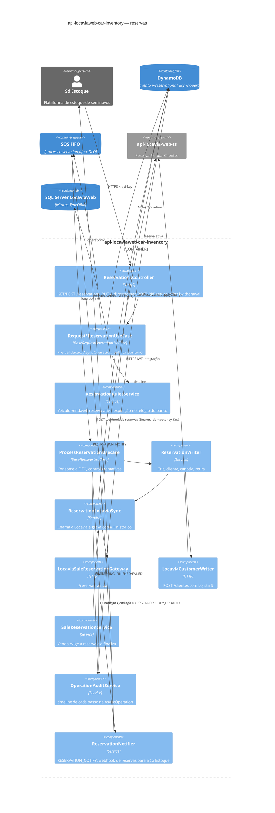
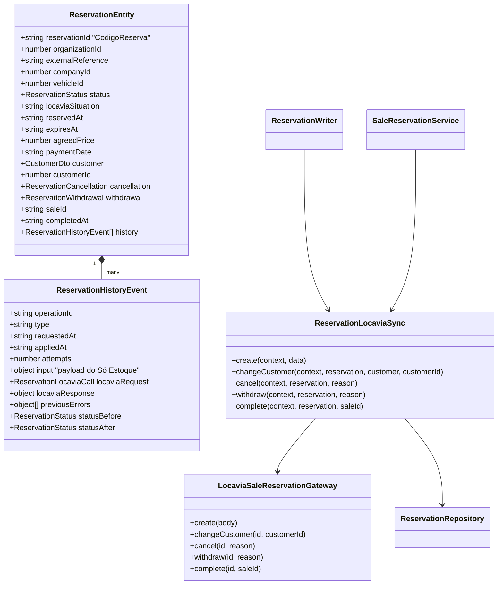
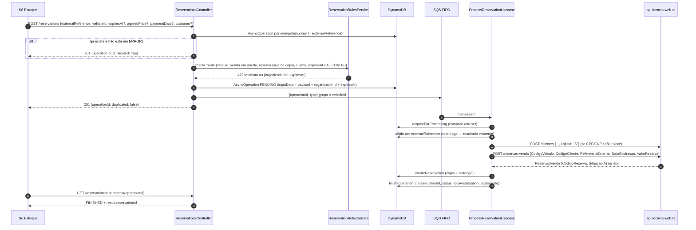
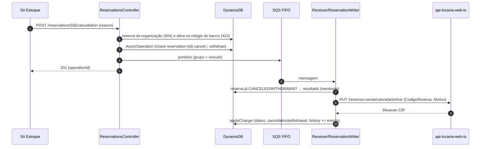

> Mantém o fluxo assíncrono do repositório, no padrão da `api-locaviaweb-integracao-asaas`: `AsyncOperation` no DynamoDB, ponteiro na SQS FIFO, receiver e endpoint de status. A gravação final passa a ser no Locavia (`/reservas-venda`), com auditoria de cada passo e notificação de volta à Só Estoque. Fontes: `reservations-instructions.md` e `reservations-assinc-instructions.md`.

# 01 — Documento de Design: Reservas do Só Estoque na integração

## 1. Considerações

#### 1.1 Premissas

- **Fluxo assíncrono obrigatório** (`reservations-assinc-instructions.md`):

  | Passo | O que acontece | Onde está implementado |
  | --- | --- | --- |
  | 1 | A Só Estoque dispara a requisição de reserva | `ReservationsController` |
  | 2 | A integração enfileira e responde o `operationId` | `Request*ReservationUseCase` (`AsyncOperation` + SQS FIFO) |
  | 3 | Processamento assíncrono, com auditoria no DynamoDB de todas as operações, e chamada ao Locavia | `ProcessReservationUsecase` → `ReservationWriter` → `ReservationLocaviaSync` |
  | 4 | O Locavia responde 2xx (aplicado) ou erro. Os dois casos são registrados no DynamoDB | `OperationAuditService` (`timeline` da operação) e histórico da reserva |
  | 5 | Mensagem à Só Estoque informando o resultado no Locavia | `ReservationNotifier`: operação `RESERVATION_NOTIFY` e webhook |

- **Decisões de 2026-11-10 sobre o fluxo:**
  - **Canal da notificação:** um webhook próprio de reservas (`API_SO_ESTOQUE_RESERVATION_WEBHOOK_URL`), com o mesmo Bearer do webhook de estoque.
  - **O que é notificado:** toda operação de reserva (criar, cliente, cancelar, retirar), tanto no **sucesso** quanto no **erro terminal**.
  - **Sucesso no Locavia:** qualquer resposta **2xx**. Hoje a inclusão responde 201 e as demais rotas 200. O status recebido fica registrado na auditoria.
- **Contrato:** é o da **primeira versão do Swagger** (`origin/dev`), sobre a qual o Só Estoque desenvolveu:

  | Contrato | Rota |
  | --- | --- |
  | Lista, operação, detalhe | `GET /reservations`, `GET /reservations/operations/{operationId}`, `GET /reservations/{id}` |
  | Reservar | `POST /reservations` |
  | Cliente da reserva | `PUT /reservations/{id}/customer` (corpo = `CustomerDto`) |
  | Cancelar | `POST /reservations/{id}/cancellation` |
  | **Retirar (novo, aditivo)** | `POST /reservations/{id}/withdrawal` |

  As rotas `POST /reservar`, `/cliente-reserva` e `/cancelar-reserva`, criadas depois e nunca publicadas, foram **removidas**.
- **Dono dos dados:** o Locavia (`ReservasVenda`). O `id` da reserva na API é o `CodigoReserva` do Locavia, como string, igual ao tipo do contrato.
- **DynamoDB:** é a **verdade dentro da integração**. Ele guarda uma cópia de cada reserva, atualizada logo após cada resposta do Locavia, com o **histórico completo** das operações. As leituras, o inventário e as pré-validações usam essa cópia.
- **Sem dado mockado no código de produção:** reserva, cliente e venda são gravados no Locavia real. Os fakes existem só nos testes.
- **Cliente:** quando não existe pelo CPF/CNPJ, é cadastrado no Locavia com `Lojista = 'S'`. Um cliente que já existe é reutilizado sem alteração.
- **Status da API:**

  | Situação no Locavia | Status da API |
  | --- | --- |
  | `A` | `ACTIVE` |
  | `F` | `COMPLETED` |
  | `R` | `WITHDRAWN` (novo valor do enum) |
  | `C` | `CANCELED` |
  | `E` | `EXPIRED` |

  Uma reserva `ACTIVE` com `expiresAt` vencido é respondida como `EXPIRED`.
- **A validar com o produto:**
  - **`WITHDRAWN`** é um valor novo no enum de `status`. Clientes do contrato com enum fechado precisam aceitá-lo.
  - **`expiresAt` e `paymentDate`** são a hora do banco do Locavia no formato UTC (`Z`). O exemplo `-03:00` do contrato inicial foi trocado por `Z`. Um envio com outro fuso é convertido para UTC, o que desloca a hora em 3 horas.

#### 1.2 Restrições

- **Escritas assíncronas, sem exceção** (padrão Asaas): a requisição valida, cria a `AsyncOperation`, publica o ponteiro na FIFO (grupo = veículo) e responde `operationId`. O receiver aplica no Locavia.
- **Locavia só por endpoints:** nenhuma escrita direta nas tabelas. As leituras de veículo, venda e cliente continuam por TypeORM no banco do Locavia, como já era feito.
- **Relógio:** as datas da reserva são a hora do banco rotulada como `Z`. Toda comparação de expiração usa `GETDATE()` do Locavia (`LocaviaVehicleRepository.currentDateTime()`), nunca o relógio do pod. Senão a reserva expiraria 3 horas antes.
- **Banco do Locavia offline nos fins de semana:** boot, Swagger e testes não dependem dele. Os e2e usam `locaviaDataFakeModule` e o fake HTTP do Locavia.

#### 1.3 Ambiente do Sistema

- **Stack:** NestJS 12, Node 24, AWS (SQS FIFO + DLQ, DynamoDB) e EKS.
- **Infraestrutura nova:** nenhuma. Usa a tabela `car-inventory-reservations` (mesma chave e mesmos GSIs) e a fila `process-reservation.fifo`, que já existem.

## 2. Arquitetura

#### 2.1 Visão Geral

**Escopo:**

- Criar, alterar o cliente, cancelar e retirar a reserva. A finalização acontece pela venda.
- Reflexo de cada operação no Locavia.
- Cópia e histórico no DynamoDB.
- Cadastro de lojista.

**Cadeia de chamada:**

```text
Só Estoque → POST /reservations → ReservationRulesService (pré-validação)
  → AsyncOperation (DynamoDB) → SQS FIFO → ProcessReservationUsecase → ReservationWriter
  → LocaviaCustomerWriter (POST /clientes, Lojista S) → ReservationLocaviaSync
  → LocaviaSaleReservationGateway (POST/PUT /reservas-venda)
  → ReservationRepository.createReservation/applyChange (cópia + histórico)
```

| Decisão | Motivo |
| --- | --- |
| `id` = `CodigoReserva` do Locavia, e `reservationId` da venda passa a ser string (até 60) | O Locavia é o dono. Volta ao tipo do contrato inicial (string, sem UUID). |
| A cópia no DynamoDB é atualizada só **depois** da resposta do Locavia | O DynamoDB nunca fica à frente do Locavia. Se a gravação da cópia falhar, a reentrega chama o Locavia de novo, e o Locavia é idempotente. |
| Histórico como lista `history` no item da reserva (`list_append`) | É uma única escrita por operação, junto com a mudança de estado, e não há tabela nova. Cada reserva tem poucas operações, bem abaixo do limite de 400 KB do item. |
| Cada evento do histórico guarda o payload recebido, a requisição e a resposta do Locavia, as tentativas e os erros anteriores, e o status antes e depois | Dá controle completo para o gerenciamento de estoque que vai consumir esses dados. |
| Uma operação que falhou antes de existir reserva fica só na `AsyncOperation` (`externalCode` = referência do Só Estoque) | Não existe `CodigoReserva` para indexar. O `externalCode-index` liga a operação à reserva. |
| `ReservationSyncModule` separado | O módulo de vendas também finaliza a reserva. Um módulo à parte evita a dependência circular Sales ↔ Reservations. |
| Pré-validação na requisição (422 imediato) e regra final no Locavia | O cliente recebe o erro na hora. O Locavia tem a palavra final, e uma recusa dele vira `ERROR` terminal (`LOCAVIA_WEB_REFUSED`). |
| Retirada como operação própria (`RESERVATION_WITHDRAW`) com a mesma forma do cancelamento | Pedido do produto. O motivo é obrigatório nos dois casos. |
| Sem job de expiração | A expiração é deduzida na leitura, e o Locavia grava `E` na próxima reserva do veículo. |
| Auditoria como `timeline` na própria `AsyncOperation` (`list_append`), não em tabela nova | Toda operação já tem esse registro, criado no passo 2, inclusive as que falham antes de existir reserva. O `externalCode-index` (referência do Só Estoque) junta todas as operações de uma reserva. |
| Notificação como operação própria (`RESERVATION_NOTIFY`) na mesma fila | Se a Só Estoque falhar, só o webhook é reprocessado, com backoff e DLQ, sem chamar o Locavia de novo. A operação de origem termina (`FINISHED`/`ERROR`) sem depender da Só Estoque. |
| A notificação é enfileirada **antes** de encerrar a operação de origem, com chave idempotente `{operationId}-notify` | Uma queda entre os dois passos reentrega a mensagem. O Locavia e a criação da notificação são idempotentes, então nada se perde nem se duplica. |
| Webhook com `Idempotency-Key` = `operationId` da operação de origem | É o mesmo id que a Só Estoque recebeu no passo 2, e permite a ela ignorar uma reentrega. |
| Grupo FIFO das notificações = `notify-{externalReference}` | Garante que as notificações de uma mesma reserva chegam na ordem (criada antes de cancelada). |

#### 2.2 Diagramas de Componentes

Arquivos Draw.io:

- `drawio-diagrams/01-reservations-contexto.drawio` (nível 1)
- `drawio-diagrams/01-reservations-car-inventory-conteineres.drawio` (nível 2)
- `drawio-diagrams/01-reservations-car-inventory-componentes.drawio` (nível 3)



**Componentes novos e alterados:**

- **`LocaviaSaleReservationGateway`** (`modules/locavia-web`): cliente das rotas `/reservas-venda`. Devolve a resposta do Locavia junto com a requisição feita, para o histórico.
- **`ReservationLocaviaSync`** (`modules/reservations/sync`): faz a chamada ao Locavia e, logo depois, grava a cópia com `createReservation` ou `applyChange`. Também converte a resposta (`changesOfLocavia`) e monta o contexto da operação (`operationContextOf`).
- **`ReservationWriter`**: aplica as operações da fila. Uma reentrega encontra a reserva já criada (pela `externalReference`) ou já na situação final.
- **`ReservationRepository`**: deixou de fazer o compare-and-set de status, porque quem decide é o Locavia.
  - `applyChange`: um único `UpdateItem` grava os campos e faz o `list_append` no histórico.
  - `createReservation`: idempotente.
  - `findActiveBy*`: recebem o "agora" do banco.
- **`LocaviaCustomerWriter.customerIdOf(..., { dealer: true })`**: envia `Lojista: 'S'` só no cadastro de cliente novo vindo da reserva.
- **`SaleReservationService`**: a venda com `reservationId` finaliza a reserva no Locavia (`PUT /reservas-venda/finalizar`), e o histórico registra a operação `SALE_CREATE`.
- **`GetInventoryUseCase`**: calcula a disponibilidade com a hora do banco (`generatedAt`).
- **`OperationAuditService`** (`data/dynamo`): grava cada passo no `timeline` da `AsyncOperation`, com `step`, `at`, `attempt` e `detail`. Uma falha ao gravar é falha do passo, e a mensagem volta para a fila.
- **`ReservationNotifier`**: `enqueue` monta o payload (sucesso com a reserva igual à do `GET /reservations/{id}`, ou falha com código e mensagem) e cria a operação `RESERVATION_NOTIFY`. `send` entrega o webhook. `recordFailure` registra a tentativa que falhou na operação de origem.
- **`SoEstoqueHttpService.notifyReservation`**: `POST` no webhook de reservas, com Bearer e `Idempotency-Key`. Um 4xx é recusa terminal. 5xx e timeout são reprocessados.
- **`LocaviaWebHttpService.exchange`**: devolve também o status HTTP do Locavia, que vai para a auditoria (passo 4).

**Passos da auditoria (`timeline`):**

| Passo | Quando | `detail` |
| --- | --- | --- |
| `REQUESTED` | Requisição aceita (passo 2) | `input`: payload completo da Só Estoque |
| `QUEUED` | Ponteiro publicado na FIFO | `groupId` |
| `PROCESSING` | Receiver pegou a operação | `redelivered` e `attempt` |
| `CUSTOMER_RESOLVED` | Cliente achado pelo CPF/CNPJ ou cadastrado como Lojista | `customerId`, `document` |
| `LOCAVIA_REQUEST` | Antes da chamada ao Locavia | `type` |
| `LOCAVIA_SUCCESS` | Locavia respondeu 2xx | `httpStatus`, `request` (rota e corpo), `response` |
| `LOCAVIA_ERROR` | Locavia recusou ou falhou | `httpStatus`, `code`, `message`, `noResponse` |
| `COPY_UPDATED` | Cópia da reserva gravada no DynamoDB | `reservationId`, `status`, `locaviaSituation` |
| `SO_ESTOQUE_NOTIFICATION_QUEUED` | Notificação criada | `notificationOperationId`, `payload` |
| `FINISHED` / `FAILED` | Fim da tentativa | resultado, ou erro com `terminal` |
| `SO_ESTOQUE_NOTIFIED` / `SO_ESTOQUE_NOTIFICATION_ERROR` | Webhook aceito ou falhou (registrado também na operação de origem) | `httpStatus`, `receiptId` ou erro |

O `GET /reservations/operations/{operationId}` passou a devolver o `timeline` (campo opcional, aditivo). O `result` da operação traz o `notificationOperationId`, que pode ser consultado na mesma rota.

#### 2.3 Diagramas de Classes



#### 2.4 Diagramas de Sequência

**Criar reserva (com cliente novo):**



**Cancelar ou retirar (`POST /reservations/{id}/cancellation|withdrawal`):**



**Fluxo assíncrono completo, com auditoria e notificação (passos 1 a 5):**

```mermaid
sequenceDiagram
  autonumber
  participant SE as Só Estoque
  participant API as api-locaviaweb-car-inventory (API)
  participant Q as SQS FIFO process-reservation
  participant RC as Receiver
  participant AU as DynamoDB (AsyncOperation.timeline)
  participant LW as api-locavia-web-ts
  SE->>API: 1. POST /reservations
  API->>AU: AsyncOperation + REQUESTED (payload)
  API->>Q: ponteiro (grupo = veículo)
  API->>AU: QUEUED
  API-->>SE: 2. 201 {operationId}
  Q->>RC: 3. mensagem
  RC->>AU: PROCESSING (tentativa)
  RC->>LW: POST /clientes (Lojista S), se o cliente for novo
  RC->>AU: CUSTOMER_RESOLVED
  RC->>AU: LOCAVIA_REQUEST
  RC->>LW: POST/PUT /reservas-venda...
  alt 2xx
    LW-->>RC: 4. 201/200 ReservasVenda
    RC->>AU: LOCAVIA_SUCCESS (httpStatus, resposta)
    RC->>AU: cópia + histórico, COPY_UPDATED
    RC->>AU: RESERVATION_NOTIFY (sucesso) + SO_ESTOQUE_NOTIFICATION_QUEUED
    RC->>Q: ponteiro da notificação (grupo notify-{referência})
    RC->>AU: FINISHED (result.notificationOperationId)
  else 4xx (recusa)
    LW-->>RC: 4. 4xx + mensagem
    RC->>AU: LOCAVIA_ERROR, FAILED terminal (DLQ)
    RC->>AU: RESERVATION_NOTIFY (falha) + SO_ESTOQUE_NOTIFICATION_QUEUED
    RC->>Q: ponteiro da notificação
  else 5xx / timeout
    RC->>AU: LOCAVIA_ERROR, FAILED (não terminal)
    Note over RC,Q: volta para a fila com backoff (passo 3 de novo)
  end
  Q->>RC: 5. RESERVATION_NOTIFY
  RC->>SE: POST webhook de reservas (Bearer, Idempotency-Key = operationId)
  alt 2xx
    RC->>AU: SO_ESTOQUE_NOTIFIED (notificação e origem)
  else erro
    RC->>AU: FAILED + SO_ESTOQUE_NOTIFICATION_ERROR na origem
    Note over RC,Q: 5xx é reprocessado; 4xx vai para a DLQ
  end
```

**Webhook de reservas para a Só Estoque (contrato provisório):**

```json
{
  "event": "reservation.create | reservation.customer | reservation.cancel | reservation.withdraw",
  "success": true,
  "operationId": "id respondido no passo 2",
  "externalReference": "SE-RES-001000",
  "reservationId": "1024",
  "occurredAt": "2026-11-10T13:00:05.000Z",
  "reservation": { "id": "1024", "status": "ACTIVE", "...": "igual a GET /reservations/{id}" },
  "error": { "code": "LOCAVIA_WEB_REFUSED", "message": "texto do Locavia (somente quando success = false)" }
}
```

**Finalizar pela venda (`POST /sales` com `reservationId`):**

- **Versão original:** o `LocaviaSaleWriter` incluía e aprovava a venda e depois chamava `SaleReservationService.complete` (`PUT /reservas-venda/finalizar`). Esse código foi removido no `cf6216d` (`02-endpoints-cleanup`).
- **Versão atual:** o fluxo volta com o backlog `03-sales` (`03-sales-design-doc-*.md`, seção "Venda × reserva").
  - O Locavia finaliza a reserva na mesma transação da venda (`POST /vendas-veiculos/integracao`).
  - A integração grava na cópia `COMPLETED`, o `saleId` e um evento `SALE_CREATE` no histórico.
  - Quando a venda é cancelada, a reserva volta para `C`, e a cópia recebe um evento `SALE_CANCEL`.
  - As regras de veículo vendável desta reserva passam a ser compartilhadas com a venda (`VehicleSaleRulesService`).

**Tratamento de erros:**

| Situação | Resultado |
| --- | --- |
| Pré-validação | 404 (reserva desconhecida), 422 (regra) ou 400 (DTO) na hora, sem nada na fila |
| 4xx do Locavia | `LocaviaWebException` 422: `ERROR` terminal, mensagem na DLQ, texto do Locavia em `lastError.cause` |
| 5xx ou timeout | Reprocessa com backoff exponencial. Quando a reserva é aplicada, o histórico guarda os erros anteriores em `previousErrors` |
| Ordem das operações | O grupo FIFO por veículo serializa as operações do mesmo veículo |

#### 2.5 Diagramas de Implantação

Mesmo deployment no EKS, com as mesmas filas e tabelas. Nenhum recurso AWS novo. A notificação usa a fila `process-reservation.fifo`, que já existe.

**Configuração nova:**

- Variável `API_SO_ESTOQUE_RESERVATION_WEBHOOK_URL`, definida em `manifests/secrets.yml` como `$(Api_So_Estoque_Reservation_Webhook_Url)`.
- O token é o mesmo `API_SO_ESTOQUE_ACCESS_TOKEN`.
- Sem a variável, a notificação fica em erro reprocessável (`SO_ESTOQUE_NOT_CONFIGURED` / 503) até a DLQ. A reserva no Locavia não é afetada. A tabela `car-inventory-reservations` mantém a chave `reservationId` e os índices `vehicleId-index`, `organizationId-index` e `externalReference-index`. Os itens agora levam `locaviaSituation`, `withdrawal`, `paymentDate` e `history`. Como o DynamoDB não tem schema, não há migração.

| Risco | Severidade | Mitigação |
| --- | --- | --- |
| Reserva alterada direto no Locavia (fora da integração) não aparece na cópia | Média | Hoje só a integração escreve em `ReservasVenda`. Se surgir uma tela, publicar evento e consumir, como na desmobilização. |
| Itens antigos (fase em que a integração era dona, UUID) sem `history`/`locaviaSituation` | Baixa | O ambiente de dev deve limpar a tabela antes do deploy. `applyChange` usa `if_not_exists(history)`. |
| `WITHDRAWN` desconhecido pelo cliente do contrato | Média | Comunicar ao Só Estoque antes de liberar a retirada. |
| Envio de datas com fuso diferente de `Z` | Média | Documentado no Swagger: a hora deve ser a do banco em UTC. |
| Contrato do webhook de reservas ainda provisório (definido pela integração) | Alta | Validar o payload e a URL com a Só Estoque antes do go-live. A notificação é isolada em `ReservationNotifier`/`SoEstoqueHttpService`. |
| Só Estoque fora do ar por muito tempo | Média | Retentativas com backoff exponencial, depois DLQ. A reserva já está no Locavia e na cópia. A Só Estoque também pode consultar `GET /reservations/operations/{id}`. |
| Item muito grande pelo histórico | Baixa | São poucas operações por reserva. Se o volume crescer, mover para uma tabela `reservation-history` (PK reservationId, SK appliedAt). |

#### 2.6 Outros Diagramas

**Item da reserva no DynamoDB (exemplo depois de criar e cancelar):**

```json
{
  "reservationId": "1024",
  "organizationId": 1,
  "externalReference": "SE-RES-001000",
  "companyId": 12,
  "vehicleId": 4521,
  "status": "CANCELED",
  "locaviaSituation": "C",
  "reservedAt": "2026-11-10T10:00:00.000Z",
  "expiresAt": "2026-11-13T10:00:00.000Z",
  "agreedPrice": 73500,
  "customerId": 9120,
  "customer": { "personType": "INDIVIDUAL", "document": "52998224725", "name": "Ana Souza" },
  "cancellation": { "reason": "Cliente desistiu", "canceledAt": "2026-11-10T15:00:00.000Z" },
  "history": [
    { "operationId": "…", "type": "RESERVATION_CREATE", "attempts": 1, "input": { "...": "payload" },
      "locaviaRequest": { "method": "POST", "route": "reservas-venda", "body": { "...": "" } },
      "locaviaResponse": { "CodigoReserva": "1024", "Situacao": "A" }, "statusAfter": "ACTIVE" },
    { "operationId": "…", "type": "RESERVATION_CANCEL", "attempts": 2, "previousErrors": [ { "httpStatus": 503 } ],
      "locaviaRequest": { "method": "PUT", "route": "reservas-venda/cancelar" },
      "statusBefore": "ACTIVE", "statusAfter": "CANCELED" }
  ]
}
```

## 3. Design de Interface do Usuário

Não se aplica, porque a integração é API. O fluxo de uso está nos diagramas de sequência (2.4) e na collection Postman (`postman/01-reservations-car-inventory.postman_collection.json`):

1. Token
2. Reservar
3. Consultar a operação
4. Ler a reserva
5. Cliente
6. Cancelar ou retirar
7. Consultar de novo

## 4. Apêndices e Referências

#### 4.1 Definições e Abreviações

| Termo | Definição |
| --- | --- |
| Cópia (integração) | Item `car-inventory-reservations` com o último estado respondido pelo Locavia e o histórico. |
| `AsyncOperation` | Registro de controle de cada escrita (status, tentativas, erros, resultado). |
| Retirada (`WITHDRAWN`/`R`) | Reserva tirada do ar pelo lojista, com motivo; libera o veículo. |
| Finalizada (`COMPLETED`/`F`) | Reserva concluída pela venda do veículo. |
| Hora do banco | `GETDATE()` do SQL Server do Locavia, exposta em formato UTC sem conversão. |

#### 4.2 Referências

**Código** (`api-locaviaweb-car-inventory`):

- `src/modules/reservations/**`
- `src/modules/reservations/sync/**`
- `src/modules/locavia-web/services/locavia-sale-reservation.gateway.ts`
- `src/data/dynamo/reservation/**`
- `src/modules/sales/services/{sale-reservation,locavia-customer-writer,locavia-sale-writer}.service.ts`
- `src/modules/inventory/usecases/get-inventory.usecase.ts`

**Testes:**

- **Unitários:** `*.spec.ts`, 35 suítes e 312 testes. Inclui `process-reservation.usecase.spec.ts` (passos 3 a 5) e `reservation-notifier.service.spec.ts`.
- **Integração (e2e):** `test/reservations.e2e-spec.ts`, `test/sales.e2e-spec.ts`, `test/inventory.e2e-spec.ts` e `test/app.e2e-spec.ts`, 9 suítes e 95 testes. O bloco "asynchronous flow" percorre os 5 passos e confere a auditoria e o webhook com o fake HTTP da Só Estoque. Usam o fake HTTP do Locavia (`test/support/locavia-web.fake-server.ts`, com as regras de `/reservas-venda`).

**Instruções:** `reservations-instructions.md` e `reservations-assinc-instructions.md`.

**Contrato inicial:** `origin/dev` (commit `1890b1d`), `src/modules/reservations/*`.

**Locavia:** `01-reservations-design-doc-api-locavia-web-ts.md`.

**Referência de padrão:** `api-locaviaweb-integracao-asaas` (AsyncOperation, receiver e idempotência).
