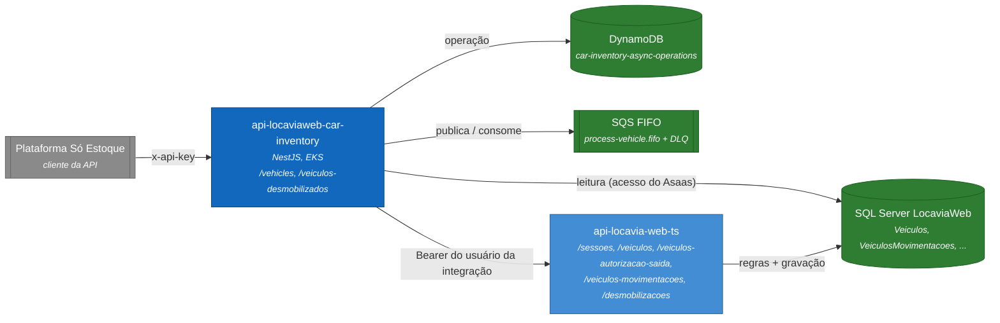
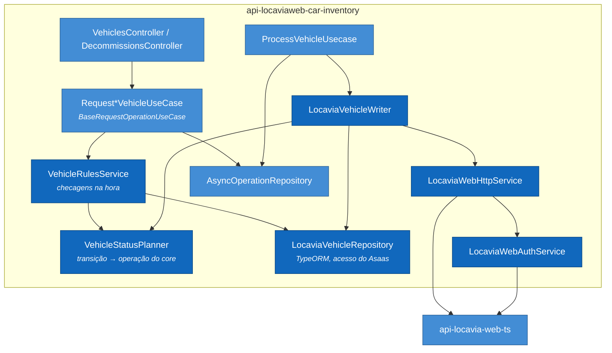
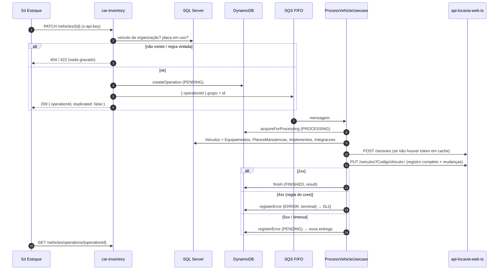
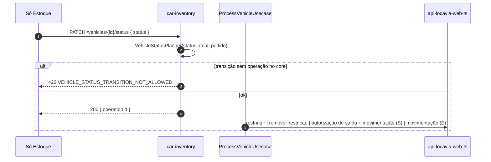

> Primeira entidade que sai do mock da `01-initial-phase`. As escritas mantêm o fluxo assíncrono já existente (operação no DynamoDB, ponteiro no SQS FIFO, receiver), no mesmo padrão do `api-locaviaweb-integracao-asaas`. O que muda é o destino: leituras no SQL Server do LocaviaWeb e escritas pelas rotas do `api-locavia-web-ts`.

# 02-vehicles - Design Doc: Veículos sobre o LocaviaWeb

|                    |                                                                                                                                                                                                                            |
| ------------------ | -------------------------------------------------------------------------------------------------------------------------------------------------------------------------------------------------------------------------- |
| Regra de negócio   | O veículo é do LocaviaWeb. A integração consulta e altera o veículo **só** pelas regras que o LocaviaWeb já aplica (cadastro, movimentação, restrição, desmobilização, exclusão). Nenhuma regra paralela.                     |
| Critério de aceite | Os endpoints de veículos da `01-initial-phase` respondem com dados reais. Cada escrita devolve `operationId`, é aplicada no LocaviaWeb pelo receiver e o resultado (ou a recusa do LocaviaWeb, traduzida) aparece em `GET .../operations/{operationId}`. |
| Repositórios       | `api-locaviaweb-car-inventory`. O `api-locavia-web-ts` é usado como está, só com rotas já versionadas: cadastro, restrição, autorização de saída, movimentação e desmobilização. Nada é criado no core.                                                       |
| Não cobre          | Reservas, vendas, ordens de serviço e envio de estoque (seguem mockados); webhook do core para a integração; pátio (`PatiosTransferencias`); autenticação definitiva com o `api-locavia-web-ts` (ver 1.1).                   |

## 1. Considerações

### 1.1 Premissas

- **Autenticação no `api-locavia-web-ts`** por um usuário padrão da integração, configurado pelo time de Infra no ENV: `LOCAVIA_WEB_LOGIN`, `LOCAVIA_WEB_PASSWORD` e `LOCAVIA_WEB_ORGANIZATION` (CNPJ da organização). Login em `POST /sessoes` (`login`, `senha`, `organizacao`). ⚠️ **A forma definitiva ainda será alinhada**: fica isolada no `LocaviaWebAuthService` para ser trocada sem mexer nos casos de uso.
- **O token do LocaviaWeb vale 10 dias e não tem refresh.** A integração guarda o token em memória até perto do `exp` e refaz o login num 401.
- **Escopo de dados**: o `api-locavia-web-ts` filtra pela organização do token e pelas empresas do usuário. ⚠️ **O usuário da integração precisa de `AcessoSimultaneoEmpresas = 'S'` e de vínculo com todas as empresas**, ou o core não enxerga veículos que a leitura da integração enxerga.
- **As leituras são no SQL Server do LocaviaWeb, com o mesmo acesso do `api-locaviaweb-integracao-asaas`** (variáveis `TYPEORM_*` alimentadas pelas variáveis de Library `Db_*`; nenhum usuário de banco novo), filtradas pela organização do CNPJ configurado (mesma consulta do login: `Organizacoes` + `Pessoas.CNPJ`).
- **Rotas do core reaproveitadas** (sem reimplementar regra):

  | Rota no `api-locavia-web-ts`                                   | Uso                                         |
  | ------------------------------------------------------------ | ------------------------------------------- |
  | `POST /veiculos`                                               | inclusão                                    |
  | `PUT /veiculos?CodigoVeiculo=`                                 | alteração                                   |
  | `DELETE /veiculos?CodigoVeiculo=`                              | exclusão                                    |
  | `PUT /veiculos/restringir` e `PUT /veiculos/remover-restricao` | bloqueio e desbloqueio                      |
  | `POST /veiculos-autorizacao-saida`                             | autorização de saída (antes de toda saída)  |
  | `POST /veiculos-movimentacoes`                                 | saída (`S`, com a autorização) e entrada (`E`) |
  | `POST /desmobilizacoes` e `PUT /desmobilizacoes/conclusao`     | desmobilização: abre e conclui              |

- **Status do LocaviaWeb** (`VeiculosStatus`): 1 Alugado, 2 Disponível, 3 Em preparação, 4 Manutenção, 5 Bloqueado, 6 Roubado, 7 Sub-locado devolvido, 8 Venda, 9 Vendido, 10 Sinistrado, 11 Preparação venda, 12 Uso interno, 13 Perda total, 14 Busca e apreensão.

### 1.2 Restrições

- **O LocaviaWeb não tem rota de "trocar status"**: o status muda como efeito de movimentação, restrição ou desmobilização. O `PATCH /vehicles/{id}/status` traduz a transição pedida para a operação dona dela (2.6).
- **`PUT /veiculos` substitui o registro inteiro** e exclui os filhos (`Equipamentos`, `PlanosManutencao`, `Implementos`, `Integracoes`) que não vierem no corpo. A alteração parcial lê o veículo e os filhos atuais e reenvia tudo.
- **`DELETE /veiculos` é exclusão física**, só com status 3 e sem integração SAP (`VeiculosSAPintegracao.IntegracaoSAPVeiculo = 'S'` recusa).
- **Saída exige o veículo Disponível (2)**, sem outra autorização de saída aberta; entrada exige que a última movimentação seja saída (ou status 3 sem movimentação) e leva o veículo a Disponível (2), salvo Perda total (13).
- **Todos os motivos de saída (1 a 12) são aceitos, com os campos que o core exige**: descrição (4, 8, 9, 10), fornecedor (1, 3), cliente e contrato (2), empresa de traslado (6), município (7). O motivo 12 (Vendido) não muda o status no core.
- **A data da movimentação (`occurredAt`) é opcional**: quando informada, vem na hora do banco do LocaviaWeb no formato UTC (`Z`) e é gravada como está (outro fuso responde 400); quando omitida, o writer usa o `GETDATE()` do banco no processamento. Datas guardadas só no DynamoDB usam o relógio da integração.
- **O contrato do Swagger muda**: os campos de texto do mock (marca, modelo, cor, combustível) viram códigos do LocaviaWeb (decisão 3).

### 1.3 Ambiente do Sistema

- Mesmo contêiner (NestJS no EKS), mesma tabela DynamoDB (`car-inventory-async-operations`) e mesma fila FIFO (`process-vehicle`).
- **Novo**: conexão SQL Server igual à do Asaas (`@nestjs/typeorm` + `mssql`, mesmas `TYPEORM_*`) e cliente HTTP do `api-locavia-web-ts` (`API_LOCAVIA_WEB_URL` + credenciais do usuário da integração).

## 2. Arquitetura

### 2.1 Visão Geral

```
Só Estoque ── GET /vehicles, /vehicles/{id}, /vehicles/{id}/movements ──▶ car-inventory ──▶ SQL Server
Só Estoque ── POST/PATCH/DELETE /vehicles..., POST /veiculos-desmobilizados ──▶ car-inventory
   ├─ valida DTO (400) e regra conferível na hora no SQL Server (404/422)
   ├─ AsyncOperation no DynamoDB (idempotencyKey) ─▶ SQS FIFO process-vehicle (grupo = veículo)
   └─ 201/200 { operationId, duplicated }
ProcessVehicleUsecase ── acquireForProcessing ──▶ LocaviaVehicleWriter
   ├─ LocaviaWebAuthService: POST /sessoes (token em cache)
   ├─▶ rota do api-locavia-web-ts (tabela 1.1)
   └─ finish(result) | registerError (4xx = negócio, terminal → DLQ; 5xx/timeout = nova tentativa)
Só Estoque ── GET /vehicles/operations/{operationId} ──▶ status da operação
```

| #   | Decisão                                                                                                                          | Motivo                                                                                                                                                                                 |
| --- | -------------------------------------------------------------------------------------------------------------------------------- | -------------------------------------------------------------------------------------------------------------------------------------------------------------------------------------- |
| 1   | **Leitura direto no SQL Server**, com o acesso do Asaas e consultas próprias                                                      | `GET /veiculos` do core não tem busca por id, devolve joins pesados e não filtra por `updatedSince`. A leitura não depende da disponibilidade do `api-locavia-web-ts`.                    |
| 2   | **Escrita sempre pelo `api-locavia-web-ts`**, nunca no banco                                                                     | As regras (placa única, MVA, limite de veículos, SAP, pátio, autorização de saída, eventos de log) ficam no dono do dado.                                                               |
| 3   | **DTOs com códigos do LocaviaWeb** (`modelId`, `colorId`, `fuelTypeId`, `ownershipSituationId`, ...)                             | O core grava códigos. Resolver texto por descrição seria frágil e deixaria campos sem destino.                                                                                          |
| 4   | **`PATCH /status` mapeado para a operação dona da transição**; o que o core não faz responde 422 na hora                          | Mantém histórico de movimentação, autorização de saída e restrição. Escrever `CodigoStatus` pelo `PUT` pularia essas regras.                                                             |
| 5   | **`DELETE` = exclusão do core**, só para veículo em preparação (3)                                                               | É a regra do LocaviaWeb para corrigir um cadastro feito por engano.                                                                                                                    |
| 6   | **Mesma fila FIFO, grupo = `CodigoVeiculo`**                                                                                     | Operações do mesmo veículo são aplicadas na ordem pedida; veículos diferentes em paralelo.                                                                                             |
| 7   | **Validação em duas camadas**: o que dá para responder na hora (existência, status, placa) no request; o core revalida no receiver | 404/422 imediatos sem enfileirar lixo. Entre o pedido e o processamento o veículo pode mudar; a palavra final é do core.                                                                  |
| 8   | **Erro 4xx do core vira 422 terminal** (DLQ), 5xx/timeout segue para nova entrega                                                 | Mesmo `LocaviaWebHttpService` do Asaas. A mensagem do core vai para `lastError.message`.                                                                                                |
| 9   | **Token do core em cache por pod**, login único concorrente, novo login num 401                                                   | Um login a cada 10 dias por pod, em vez de um por operação.                                                                                                                             |
| 10  | **Idempotência**: chave do cliente (`x-idempotency-key`) ou chave natural (`vehicle-chassis-{chassi}`, `vehicle-{id}-delete`, `vehicle-{id}-decommission`) | Reenvio do mesmo pedido devolve a mesma operação. No reprocessamento, o writer reaproveita a autorização de saída aberta do mesmo motivo, reconhece a movimentação já gravada e conclui a desmobilização deixada aberta.                                 |

### 2.2 Diagramas de Componentes

Também em Draw.io: [`drawio-diagrams/02-vehicles-conteineres.drawio`](drawio-diagrams/02-vehicles-conteineres.drawio) e [`drawio-diagrams/02-vehicles-componentes.drawio`](drawio-diagrams/02-vehicles-componentes.drawio).

#### Nível 2: Contêineres

Objetivo: mostrar que a leitura vai ao banco e a escrita vai ao core, sempre passando pela fila.



#### Nível 3: Componentes



| Componente                 | Responsabilidade                                                                                                                                              |
| -------------------------- | ------------------------------------------------------------------------------------------------------------------------------------------------------------- |
| `LocaviaVehicleRepository` | Consultas do veículo, filtros da listagem, movimentações e desmobilização em aberto; leitura crua do registro e dos filhos para o `PUT`. Sempre filtrando a organização. |
| `VehicleRulesService`      | Regras que o core aplica e que dá para responder na hora: existência, placa em uso, empresa da organização, status para excluir, saída, entrada e desmobilização. |
| `VehicleStatusPlanner`     | Tabela de transições suportadas (2.6): devolve a operação do core ou o erro 422.                                                                               |
| `LocaviaVehicleWriter`     | Monta o corpo de cada rota do core (inclusive o merge do `PUT`) e devolve o resultado da operação.                                                            |
| `LocaviaWebHttpService`    | `get/post/put/delete` no core, desembrulha `ResponseHTTP`, traduz erro (4xx → 422; 5xx/timeout → transitório) e repete uma vez num 401 com token novo.         |
| `LocaviaWebAuthService`    | Login `POST /sessoes` com o ENV, cache do token até o `exp`, um login por vez.                                                                                 |

### 2.3 Diagramas de Classes

Não se aplica. Os casos de uso seguem o `BaseRequestOperationUseCase` / `BaseReceiverUseCase` já existentes; as estruturas novas são as entidades de leitura e os contratos (2.6).

### 2.4 Diagramas de Sequência

#### Fluxo 1: Escrita (exemplo: alteração parcial)



- **401 do core** com token em cache: o `LocaviaWebHttpService` descarta o token, faz novo login e repete a chamada uma vez.
- **Falha no login** (credencial do ENV errada ou core fora): erro transitório; a operação volta a ser entregue até a DLQ pelo `maxReceiveCount`.

#### Fluxo 2: Troca de status



### 2.5 Diagramas de Implantação

| Item                 | Mudança                                                                                                                                   |
| -------------------- | ----------------------------------------------------------------------------------------------------------------------------------------- |
| Secret do ambiente   | `TYPEORM_HOST/PORT/USERNAME/PASSWORD/DATABASE/ENCRYPT/POOL_MIN/POOL_MAX`, `LOCAVIA_WEB_LOGIN/PASSWORD/ORGANIZATION`, `API_LOCAVIA_WEB_URL`. |
| SQL Server           | Nada novo: o mesmo acesso do `api-locaviaweb-integracao-asaas` (variáveis `Db_*` da Library).                                             |
| LocaviaWeb           | Usuário da integração ativo, senha sem expiração, `AcessoSimultaneoEmpresas = 'S'` e vínculo com todas as empresas.                        |
| Rede                 | Pod do car-inventory alcança o SQL Server e o `api-locavia-web-ts` na VPC.                                                                |

- **Escalabilidade**: pool SQL pequeno (`TYPEORM_POOL_MAX`) por pod; o receiver processa 5 mensagens por vez por pod. A ordem por veículo é garantida pelo grupo FIFO, não pelo número de pods.
- **Operação**: operação em `ERROR` não bloqueia; o cliente corrige a origem e pede de novo (a chave natural é liberada).

### 2.6 Outros Diagramas

#### Contrato dos endpoints

| Endpoint                                         | Tipo da operação          | Regra conferida na hora                                                         | Rota do core                                   |
| ------------------------------------------------ | ------------------------- | ------------------------------------------------------------------------------- | ---------------------------------------------- |
| `GET /vehicles`                                  | leitura                   | filtros `companyId`, `status[]`, `reserved`, `licensePlate`, `brandId`, `modelId`, `updatedSince`, paginação | -                                    |
| `GET /vehicles/{id}`                             | leitura                   | 404                                                                             | -                                              |
| `GET /vehicles/{id}/movements`                   | leitura                   | 404; mais recentes primeiro                                                     | -                                              |
| `POST /vehicles`                                 | `VEHICLE_CREATE`          | empresa de compra (salvo situação 4); placa livre; empresa, modelo, cor e combustível da organização (regra da integração) | `POST /veiculos` (nasce em preparação, 3)       |
| `PATCH /vehicles/{id}`                           | `VEHICLE_UPDATE`          | existe; placa livre só se a empresa tem `PermitirAlteracaoPlacaVeiculo = 'N'` | `PUT /veiculos?CodigoVeiculo=`                  |
| `DELETE /vehicles/{id}`                          | `VEHICLE_DELETE`          | status 3; não enviado ao SAP                                                    | `DELETE /veiculos?CodigoVeiculo=`               |
| `PATCH /vehicles/{id}/status`                    | `VEHICLE_CHANGE_STATUS`   | tabela de transições abaixo                                                     | restrição ou movimentação                      |
| `POST /vehicles/{id}/movements`                  | `VEHICLE_MOVE`            | saída: status 2, sem autorização aberta, campos do motivo; entrada: última movimentação é saída (ou status 3); hodômetro ≥ atual | saída: `POST /veiculos-autorizacao-saida` + `POST /veiculos-movimentacoes`; entrada: `POST /veiculos-movimentacoes` |
| `POST /veiculos-desmobilizados`                  | `VEHICLE_DECOMMISSION`    | status 11, sem desmobilização aberta ou concluída                               | `POST /desmobilizacoes` + `PUT /desmobilizacoes/conclusao?CodigoDesmobilizacao=` |
| `GET /vehicles/operations/{id}`, `GET /veiculos-desmobilizados/operations/{id}` | status            | 404 se a operação não é do módulo                                               | -                                              |

#### Transições do `PATCH /vehicles/{id}/status`

| Status atual                                                           | Pedido                     | Operação no core                                                     |
| ---------------------------------------------------------------------- | -------------------------- | -------------------------------------------------------------------- |
| qualquer, sem restrição                                                | `BLOCKED`                  | `PUT /veiculos/restringir` (`restrictionId` obrigatório; `restrictionCustomerId` quando a restrição vincula cliente) |
| `BLOCKED`                                                              | status anterior à restrição | `PUT /veiculos/remover-restricao`                                    |
| `AVAILABLE` (2)                                                        | `SALE_PREPARATION`         | saída, motivo 11 (Preparação venda)                                  |
| `AVAILABLE` (2)                                                        | `FOR_SALE`                 | saída, motivo 10 (à Venda; `reason` obrigatório)                     |
| `AVAILABLE` (2)                                                        | `INTERNAL_USE`             | saída, motivo 9 (Uso interno; `reason` obrigatório)                  |
| qualquer, menos `TOTAL_LOSS` (13) e `BLOCKED`                         | `AVAILABLE`                | entrada (`E`), fecha a última saída                                  |
| `SALE_PREPARATION` (11)                                                | `FOR_SALE`                 | 422 `VEHICLE_STATUS_USE_DECOMMISSION`: usar `POST /veiculos-desmobilizados` |
| demais                                                                 | -                          | 422 `VEHICLE_STATUS_TRANSITION_NOT_ALLOWED`                          |

Hodômetro e empresa da movimentação vêm do pedido ou, se omitidos, do veículo atual. A data (`DataHora`) é o `occurredAt` informado ou, se omitido, o `GETDATE()` do banco no processamento; informada, não pode ser anterior à última movimentação (422).

#### Mapeamento de campos (inclusão e alteração)

| Campo da API                                 | Coluna `Veiculos`                      |
| -------------------------------------------- | -------------------------------------- |
| `companyId`                                  | `CodigoEmpresa`                        |
| `licensePlate`, `chassis`, `renavam`, `mva`  | `Placa`, `Chassi`, `Renavam`, `CodigoMVA` |
| `modelId`, `colorId`, `fuelTypeId`           | `CodigoModelo`, `CodigoCor`, `CodigoTipoCombustivel` |
| `manufactureYear` + `modelYear`              | `AnoFabricacaoModelo` (`AAMM`, ex.: 2023/2024 → `2324`) |
| `ownershipSituationId`, `saleRestriction`    | `CodigoSituacaoProprietario`, `RestricaoVenda` (0, 1, 2, 3, 9) |
| `odometer`, `fuelLevel`, `doors`, `passengers`, `yardId`, `classificationId`, `notes` | `Hodometro`, `NivelCombustivel`, `NumeroPortas`, `NumeroPassageiros`, `CodigoPatio`, `CodigoVeiculosClassificacao`, `Observacao` |
| `purchase.{date, invoiceNumber, supplierId, companyId, amount}` | `DataCompra`, `NumeroNFCompra`, `CodigoFornecedorCompra`, `CodigoEmpresaCompra` (obrigatório salvo situação 4), `ValorCompra` |
| `sale.{expectedDate, expectedAmount}`        | `DataPrevistoVenda`, `ValorPrevistoVenda` |

Somente leitura na resposta: `status` + `locaviaStatus {code, letter}`, `statusBeforeRestriction`, `reserved` (`CodigoGrupoContratoReservado`), `sale.listedAt` (`DataEntradaVenda`, gravada pelo core na saída para Preparação venda ou Venda, não na conclusão da desmobilização), descrições de modelo, marca, cor, combustível e pátio, `createdAt`, `updatedAt` (`ModificadoEm` ou `InseridoEm`; base do `updatedSince`).

**Datas:** a hora é sempre a mesma do SQL Server do LocaviaWeb, no formato UTC (`Z`), sem conversão de fuso na entrada nem na saída, como no `api-locavia-web-ts` (`useUTC: true`). `InseridoEm` 19:25:27 sai como `2026-11-03T19:25:27.000Z`, e `updatedSince=2026-11-03T19:00:00Z` compara com 19:00 do banco. O `occurredAt` da movimentação e da troca de status é opcional: informado, segue esse formato e vai como está para a `DataHora`; omitido, o writer envia o `GETDATE()` do banco. As datas do checklist da desmobilização vêm do cliente, no mesmo formato.

#### Conflitos e duplicidades

| #   | Risco                                                           | Tratamento                                                                                                  |
| --- | --------------------------------------------------------------- | ----------------------------------------------------------------------------------------------------------- |
| C1  | Mesmo pedido enviado duas vezes                                 | Mesma `idempotencyKey` devolve a operação existente (`duplicated: true`), nada é publicado.                 |
| C2  | Operação reprocessada depois de o core ter gravado              | `acquireForProcessing` (compare-and-set); o writer reconhece a movimentação já gravada, reaproveita a autorização aberta e conclui a desmobilização aberta. A inclusão repetida esbarra na placa única do core (422). |
| C3  | Alteração concorrente feita na tela do LocaviaWeb               | O `PUT` lê o registro no processamento, não no pedido: só os campos pedidos sobrescrevem.                    |
| C4  | Veículo muda entre o pedido e o processamento                   | O core revalida; a recusa fica em `lastError` como 422.                                                     |

## 3. Design de Interface do Usuário

Não se aplica: API consumida pela Plataforma Só Estoque.

## 4. Apêndices e Referências

### 4.1 Definições e Abreviações

| Termo                  | Definição                                                                                   |
| ---------------------- | ------------------------------------------------------------------------------------------- |
| Core                   | `api-locavia-web-ts`, dono das regras e do SQL Server do LocaviaWeb.                         |
| AsyncOperation         | Registro da operação assíncrona no DynamoDB (`operationId`, `status`, `result`, `lastError`). |
| Autorização de saída   | `VeiculosAutorizacaoSaida`: pré-requisito do core para a saída do veículo.                    |
| Desmobilização         | Saída do veículo da frota para a venda (11 → 8), com checklist.                             |

### 4.2 Referências

- `api-locaviaweb-car-inventory`: `src/common/usecases/base-request-operation.usecase.ts`, `src/common/usecases/base-receiver.usecase.ts`, `src/modules/vehicles/`, `src/modules/receiver/usecases/process-vehicle.usecase.ts`.
- `api-locaviaweb-integracao-asaas`: `src/modules/locavia-web/services/locavia-web-http.service.ts`, `src/infra/config/typeorm-mssql.factory.ts`.
- `api-locavia-web-ts`: `src/modules/sistema/usuarios/useCase/AutenticacaoUsuario`, `src/modules/cadastros/veiculos/useCase/{Create,Update,Delete,RestringirVeiculos,RemoverRestricaoVeiculos}`, `src/modules/locacoes/veiculosMovimentacoes/useCase/CreateVeiculosMovimentacoes`, `src/modules/locacoes/veiculosAutorizacaoSaida/`, `src/modules/desmobilizacao/desmobilizacoes/` (`CreateDesmobilizacao`, `ConcluirDesmobilizacao`).
- Arquitetura: `product-backlog/Arquitetura de integração Estoque-1 1.pdf`.

### 4.3 Riscos

| Severidade | Risco                                                                                                   | Mitigação                                                                                  |
| ---------- | ------------------------------------------------------------------------------------------------------- | ------------------------------------------------------------------------------------------ |
| Alta       | Saída e desmobilização são duas chamadas ao core, sem transação entre elas                               | O reprocessamento retoma do passo gravado (autorização aberta, desmobilização aberta); a recusa fica em `lastError`. |
| Alta       | Usuário da integração sem acesso a todas as empresas: o core devolve 404 para veículo que a leitura mostra | Pré-requisito de Infra (2.5); o 404 do core fica em `lastError`.                           |
| Média      | Credencial no ENV, com troca de senha manual e token de 10 dias                                         | Isolada no `LocaviaWebAuthService`; substituir quando a autenticação for alinhada.         |
| Média      | `PUT /veiculos` apaga filhos não enviados                                                               | Leitura dos 4 filhos no processamento e reenvio integral; teste e2e cobre.                 |
| Baixa      | Motivo 12 (Vendido) não muda o status no core                                                           | Comportamento do core (`CreateVeiculosMovimentacoes` sem caso para 12); a venda é tratada no módulo de vendas. |
