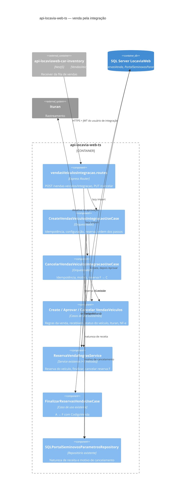
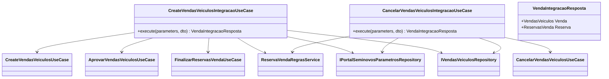
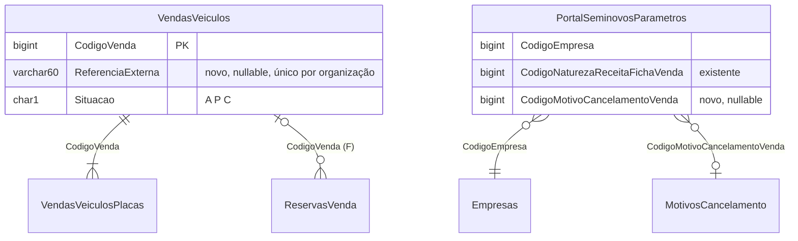

> Dois casos de uso orquestradores novos no módulo `seminovos/vendasVeiculos`. Eles reaproveitam `CreateVendasVeiculos`, `AprovarVendasVeiculos`, `CancelarVendasVeiculos` e as regras de `ReservaVendaRegrasService` numa única transação (`autoTransaction`, propagação `REQUIRED`), no padrão de rotas e de erros do módulo `seminovos/reservasVenda`.

# 03 — Documento de Design: Venda pela integração (`vendas-veiculos/integracao`) no Locavia

## 1. Considerações

#### 1.1 Premissas

- O Locavia é o **sistema de registro** da venda. Ele guarda a venda e aplica as regras de negócio. A integração `api-locaviaweb-car-inventory` só chama os endpoints dele e nunca grava direto no banco.
- **Reaproveitar o que existe:** as regras da venda (empresa e tipo de documento, veículo 8/13, alienação, cliente bloqueado, venda em aberto, natureza de receita) e os efeitos da aprovação e do cancelamento (status do veículo, recebíveis, Ituran, nota fiscal, assinatura digital) continuam nos casos de uso atuais. Os orquestradores só montam a entrada, chamam esses casos de uso em ordem e cuidam do que eles não fazem: idempotência, reserva e códigos de configuração.
- **Por que um orquestrador e não as rotas atuais** (decidido em 2026-11-10):

  | Problema das rotas atuais para uma integração | Como o orquestrador resolve |
  | --- | --- |
  | Inclusão, aprovação e finalização da reserva são três chamadas, sem atomicidade | Uma transação. Uma falha no meio desfaz tudo |
  | A inclusão não é idempotente (nenhuma coluna de referência externa) | Coluna nova `VendasVeiculos.ReferenciaExterna`, única por organização |
  | A aprovação repetida responde 400 ("já foi aprovada"), que a integração trataria como recusa terminal | A reentrega devolve a venda existente com 201 |
  | Os controllers legados respondem 400 para qualquer erro | O controller usa `statusDoErro`, como em `reservasVenda`: 404, 409 e 422 tipados, 500 para erro inesperado |
  | A venda não consulta `ReservasVenda`: um veículo reservado para um cliente pode ser vendido para outro | O orquestrador recusa com 409 e finaliza a reserva informada |
  | O cancelamento não mexe na reserva, e uma reserva `F` de venda cancelada bloqueia o veículo para sempre | O orquestrador leva a reserva `F` da venda para `C` |

- **Venda e reserva usam as mesmas regras.** O `ReservaVendaRegrasService` já implementa as regras da inclusão da venda, porque a reserva antecipa a venda. O orquestrador usa esse serviço em vez de escrever regras novas:

  | Regra do orquestrador | Método reaproveitado |
  | --- | --- |
  | Veículo existe, status 8/13, não alienado, sem venda em aberto (todas as linhas de placa) | `validarVeiculo` |
  | Cliente existe e não está bloqueado | `validarCliente` |
  | Sem `CodigoReserva`: reservas `A` vencidas viram `E`; `A` ou `F` restante → 409 | `validarVeiculoSemReserva` |
  | Com `CodigoReserva`: existe, está `A` e não vencida, é do mesmo veículo | `buscarReserva` + `validarReservaAtiva` |
  | Com `CodigoReserva`: nenhuma **outra** reserva `A`/`F` no veículo | `validarVeiculoSemReserva(..., codigoReservaIgnorada)` (parâmetro novo, opcional) |
  | Finalizar a reserva com a venda (venda não cancelada e com o veículo) | `FinalizarReservasVenda` → `validarVendaDoVeiculo` |
  | Cancelar a reserva `F` da venda cancelada | `cancelarReservaDaVenda` (método novo) |

  O `CreateVendasVeiculos` repete parte dessas regras (8/13, alienação, cliente, venda em aberto). A repetição é intencional: a regra da tela continua valendo, e o `validarVeiculo` corrige a falha do `findOne` na venda em aberto (2.5).
- **Códigos de configuração vêm do Locavia, não da Só Estoque:**

  | Campo da venda | Origem |
  | --- | --- |
  | `CodigoEmpresa` | Empresa do veículo |
  | `CodigoEmpresaRecebimento` | Mesma empresa do veículo |
  | `CodigoNaturezaReceita` | `PortalSeminovosParametros.CodigoNaturezaReceitaFichaVenda` da empresa (`Ativo = 'S'`) |
  | `CodigoTipoMidia` | `TiposMidia` pela descrição recebida (`salesChannel`), sem diferenciar maiúsculas; sem correspondência fica nulo |
  | `CodigoMotivoCancelamento` | `PortalSeminovosParametros.CodigoMotivoCancelamentoVenda` da empresa (**coluna nova**) |

- **Sem formas de pagamento** (decidido em 2026-11-10): a venda é aprovada sem `FormasPagamento`. O veículo vai para Vendido (`9`), mas não são gerados recebíveis.
- **Cancelamento de venda com reserva finalizada** (decidido em 2026-11-10): a reserva `F` ligada à venda vai para `C` com o motivo "Venda cancelada.", e o veículo fica livre para nova reserva.
- **A validar com o produto:**
  - `CodigoEmpresaRecebimento` igual à empresa do veículo.
  - Venda sem recebíveis (ver acima).
  - O orquestrador de cancelamento recusa vendas sem `ReferenciaExterna`, ou seja, feitas pela tela.
  - **Fora do escopo:** a tela (`POST /vendas-veiculos`) continua sem consultar `ReservasVenda`. O risco segue registrado em 2.5.

#### 1.2 Restrições

- **Datas:** seguem o padrão do Locavia, a hora de Brasília do banco rotulada como `Z` (`dataAjustada()`), sem conversão de fuso. `DataVenda` é só a data.
- **Erros:** no padrão `{ status, statusCode, data, erros: [{ message }] }`. As exceções tipadas (`NotFound` 404, `Conflict` 409, `UnprocessableEntity` 422) recebem só a mensagem, de `VendaVeiculoIntegracaoMensagemConstant`, em texto simples e sem código. Os `throw { message }` dos casos de uso legados saem como 400, que a integração também trata como recusa de negócio terminal.
- **Transações:** toda a operação roda num `TransactionManager().autoTransaction`. Os casos de uso chamados abrem o próprio `autoTransaction`, e a propagação padrão (`REQUIRED`) faz com que entrem na transação do orquestrador. As consultas são feitas em sequência, porque `Promise.all` dentro da transação gera `EREQINPROG`.
- **Efeito externo da aprovação:** `AprovarVendasVeiculos` desativa o rastreador Ituran logo depois do `autoTransaction` dele. No orquestrador isso acontece antes do `COMMIT` final. Por isso a aprovação é o **último passo**.
- **Usuário:** as chamadas chegam com o usuário de integração (`POST /sessoes`). Ele aparece em `InseridoPor`, `ModificadoPor`, `CodigoUsuarioCancelamento` e no log `Transacoes`.

#### 1.3 Ambiente do Sistema

- Node.js, Express 5 e TypeORM 0.3 sobre SQL Server (banco único multi-organização, filtrado por `CodigoOrganizacao`), no mesmo processo e deploy do `api-locavia-web-ts`.
- As rotas são descobertas automaticamente (`*.routes.ts`) e as migrations rodam no boot (`runMigrations`).
- Não há infraestrutura nova.

## 2. Arquitetura

#### 2.1 Visão Geral

**Escopo:**

- Coluna `VendasVeiculos.ReferenciaExterna`, com índice único filtrado por organização.
- Coluna `PortalSeminovosParametros.CodigoMotivoCancelamentoVenda`, no CRUD de parâmetros (entidade, validador e Swagger).
- Casos de uso `CreateVendasVeiculosIntegracao` e `CancelarVendasVeiculosIntegracao` com o controller, as rotas, o Swagger e os testes unitários.
- Método novo em `ReservaVendaRegrasService` para cancelar a reserva finalizada por uma venda.

**Cadeia de chamada:** integração (receiver) → `POST /vendas-veiculos/integracao` → `CreateVendasVeiculosIntegracaoUseCase` → `ReservaVendaRegrasService` + `CreateVendasVeiculosUseCase` + `FinalizarReservasVendaUseCase` + `AprovarVendasVeiculosUseCase` → `VendasVeiculos`, `VendasVeiculosPlacas`, `ReservasVenda`, `Veiculos`.

| Decisão | Motivo |
| --- | --- |
| Rotas `POST /vendas-veiculos/integracao` e `PUT /vendas-veiculos/integracao/cancelar` | Ficam no módulo da venda, seguem o padrão do Locavia (código no corpo, sem `/:id`) e separam o contrato da integração do contrato da tela. |
| Reaproveitar os casos de uso pelo `execute` | Não duplica nenhuma regra. Uma correção na regra da tela vale para a integração. |
| Ordem: validar reserva → incluir → finalizar reserva → aprovar | A aprovação tem um efeito externo (Ituran) que não é desfeito por `ROLLBACK`. Ela fica por último, depois de tudo que pode falhar. |
| `ReferenciaExterna` única por organização (índice filtrado) e criação idempotente | A reentrega da fila devolve a mesma venda. Uma referência já usada em outro veículo responde 409. |
| Cancelamento idempotente | Uma venda já cancelada é devolvida sem alteração (200). O caso de uso legado não checa isso e regravaria o usuário e a hora do cancelamento. |
| Resposta com a venda e a reserva (`{ Venda, Reserva }`) | A integração atualiza as duas cópias com uma única chamada. |
| Motivo em texto acrescentado às `Observacoes` da venda | A tabela não tem coluna de motivo livre. O código fica em `CodigoMotivoCancelamento`, e o texto da Só Estoque fica visível na tela da venda. |
| Configuração em `PortalSeminovosParametros`, por empresa | É onde já está a natureza de receita da ficha de venda do portal de seminovos. Não usa variável de ambiente nem envio de código pela Só Estoque. |

#### 2.2 Diagramas de Componentes

Arquivos Draw.io:

- `drawio-diagrams/03-sales-contexto.drawio` (C4 nível 1)
- `drawio-diagrams/03-sales-locavia-componentes.drawio` (C4 nível 3)
- `drawio-diagrams/03-sales-fluxos.drawio` (fluxos de venda e cancelamento)



**Componentes novos:**

- **`CreateVendasVeiculosIntegracaoUseCase`** (`useCase/CreateVendasVeiculosIntegracao/`). Recebe o DTO `{ ReferenciaExterna, CodigoVeiculo, CodigoCliente, CodigoReserva?, DataVenda, ValorVenda, TipoMidia? }` e o valida com `yup` (`createVendasVeiculosIntegracaoValidator`).
- **`CancelarVendasVeiculosIntegracaoUseCase`** (`useCase/CancelarVendasVeiculosIntegracao/`). Recebe o DTO `{ CodigoVenda, Motivo }` (motivo obrigatório, até 200).
- **`ReservaVendaRegrasService.validarVeiculoSemReserva(parameters, codigoVeiculo, agora, codigoReservaIgnorada?)`**: parâmetro novo e opcional. Sem ele, o comportamento da inclusão da reserva não muda.
- **`ReservaVendaRegrasService.cancelarReservaDaVenda(parameters, CodigoVenda)`**: procura a reserva `F` com aquele `CodigoVenda` e a atualiza para `C`, com `Motivo = "Venda cancelada."` e `DataHoraSituacao`. Devolve a reserva ou `undefined`.
- **`VendaVeiculoIntegracaoMensagemConstant`**: mensagens em texto simples.

**Alterados:**

- `VendasVeiculos.entity.ts` e `VendaVeiculo.ts` ganham `ReferenciaExterna?`. O construtor **não** define um valor padrão, para que um `PUT /vendas-veiculos` da tela não apague a referência.
- `PortalSeminovosParametros.entity.ts`, o validador e o Swagger ganham `CodigoMotivoCancelamentoVenda` (opcional no CRUD, obrigatório só no cancelamento pela integração).
- Swagger: `src/shared/swagger/swagger.{tags,paths,definitions}.ts`.

#### 2.3 Diagramas de Classes

O módulo segue a estrutura mecânica do repositório: um caso de uso por ação, com DTO, interface, validador `yup` e controller, mais `index.ts` com a injeção. A única relação nova é a composição dos casos de uso existentes, mostrada abaixo.



#### 2.4 Diagramas de Sequência

**Venda (`POST /vendas-veiculos/integracao`):**

```mermaid
sequenceDiagram
  autonumber
  participant CI as car-inventory (receiver)
  participant UC as CreateVendasVeiculosIntegracao
  participant P as PortalSeminovosParametros
  participant R as ReservaVendaRegrasService
  participant CV as CreateVendasVeiculos
  participant FR as FinalizarReservasVenda
  participant AP as AprovarVendasVeiculos
  participant DB as SQL Server
  CI->>UC: POST {ReferenciaExterna, CodigoVeiculo, CodigoCliente, CodigoReserva?, DataVenda, ValorVenda, TipoMidia?}
  UC->>UC: yup
  UC->>DB: BEGIN (autoTransaction)
  UC->>DB: VendasVeiculos por ReferenciaExterna
  alt já existe (reenvio)
    UC-->>CI: 201 {Venda, Reserva} (outro veículo → 409)
  end
  UC->>R: validarVeiculo (404, 8/13, alienação, venda em aberto) → CodigoEmpresa
  UC->>R: validarCliente (404, bloqueado)
  UC->>P: parâmetros ativos da empresa
  P-->>UC: CodigoNaturezaReceitaFichaVenda (422 se ausente)
  alt com CodigoReserva
    UC->>R: buscarReserva (404) + validarReservaAtiva (422) + mesmo veículo (422)
    UC->>R: validarVeiculoSemReserva(ignorando CodigoReserva) → 409 se houver outra A/F
  else sem CodigoReserva
    UC->>R: validarVeiculoSemReserva → A vencidas viram E; 409 se houver A/F
  end
  UC->>DB: TiposMidia por descrição (opcional)
  UC->>CV: execute (empresa, cliente, natureza, ReferenciaExterna, Veiculos[1])
  Note over CV: regras existentes: tipo de documento, 8/13, alienação,<br/>cliente bloqueado, venda em aberto
  CV-->>UC: Venda (Situacao A)
  opt CodigoReserva
    UC->>FR: execute {CodigoReserva, CodigoVenda}
    FR-->>UC: Reserva (Situacao F)
  end
  UC->>AP: execute {CodigoVenda}
  Note over AP: Situacao P, veículo 8/13 → 9, sem recebíveis,<br/>Ituran desativado (último passo)
  UC->>DB: COMMIT
  UC-->>CI: 201 {Venda, Reserva}
```

**Cancelamento (`PUT /vendas-veiculos/integracao/cancelar`):**

```mermaid
sequenceDiagram
  autonumber
  participant CI as car-inventory (receiver)
  participant UC as CancelarVendasVeiculosIntegracao
  participant P as PortalSeminovosParametros
  participant CA as CancelarVendasVeiculos
  participant R as ReservaVendaRegrasService
  participant DB as SQL Server
  CI->>UC: PUT {CodigoVenda, Motivo}
  UC->>UC: yup
  UC->>DB: BEGIN
  UC->>DB: venda (404); sem ReferenciaExterna → 422
  alt já cancelada (reenvio)
    UC-->>CI: 200 {Venda, Reserva}
  end
  UC->>P: parâmetros ativos da empresa da venda
  P-->>UC: CodigoMotivoCancelamentoVenda (422 se ausente)
  UC->>CA: execute {CodigoVenda, CodigoMotivoCancelamento}
  Note over CA: regras existentes: NF-e, recebíveis quitados;<br/>veículo 9 → 8/13; recebíveis excluídos
  UC->>DB: Observacoes += "Cancelamento Só Estoque: {Motivo}"
  UC->>R: cancelarReservaDaVenda(CodigoVenda)
  R->>DB: ReservasVenda F → C ("Venda cancelada.")
  UC->>DB: COMMIT
  UC-->>CI: 200 {Venda, Reserva?}
```

**Decisões não óbvias:**

- **Idempotência:** é o que permite à integração reprocessar a mensagem sem consultar antes. A criação usa `ReferenciaExterna`; o cancelamento usa a própria situação da venda.
- **Reserva de outra pessoa:** se o veículo tem uma reserva `A` ou `F` e o `CodigoReserva` não é ela, a resposta é 409. A integração já faz essa pré-validação, mas o Locavia tem a palavra final.
- **Erros:** um erro de validação ou de regra responde 4xx e a integração não tenta de novo. Um erro inesperado responde 500 e a integração reprocessa com backoff. Como tudo está numa transação, uma tentativa que falhou não deixa nada gravado.

**Mensagens novas** (`VendaVeiculoIntegracaoMensagemConstant`):

| Situação | Status | Mensagem |
| --- | --- | --- |
| Referência já usada em outro veículo | 409 | A referência externa informada já pertence a uma venda de outro veículo. |
| Natureza de receita não configurada | 422 | A empresa do veículo não possui natureza de receita da ficha de venda configurada nos parâmetros do portal de seminovos. |
| Motivo de cancelamento não configurado | 422 | A empresa da venda não possui motivo de cancelamento de venda configurado nos parâmetros do portal de seminovos. |
| Veículo com reserva de outra pessoa | 409 | O veículo informado possui uma reserva de venda ativa ou finalizada diferente da informada. |
| Venda sem referência externa | 422 | A venda informada não foi realizada pela integração. |

#### 2.5 Diagramas de Implantação

Não há contêiner novo. O código é publicado com o `api-locavia-web-ts`, e as migrations rodam no boot.

| Risco | Severidade | Mitigação |
| --- | --- | --- |
| Venda pela tela de um veículo reservado: `CreateVendasVeiculos` não consulta `ReservasVenda` | Alta | Fora deste escopo. Próximo passo sugerido: chamar `validarVeiculoSemReserva` no `CreateVendasVeiculosPlacas` com uma opção de ignorar a reserva sendo finalizada. |
| Ituran desativado e `COMMIT` falha logo depois | Baixa | A aprovação é o último passo, e só o `COMMIT` pode falhar depois dela. Esse risco também existe hoje na tela. |
| `PortalSeminovosParametros` sem as configurações na empresa | Média | A integração recebe 422 com mensagem clara e avisa a Só Estoque. Configurar antes do go-live. |
| `NumeroVenda` por `MAX+1` sem lock | Baixa | Já existe hoje. A integração processa uma venda por vez. |
| `CreateVendasVeiculosPlacas` lê só uma linha (`findOne`) na regra de venda em aberto | Baixa | A pré-validação da integração e o `validarVeiculo` da reserva olham todas as linhas. Corrigir em uma tarefa à parte. |
| Índice único filtrado exige `ANSI_NULLS` e `QUOTED_IDENTIFIER` | Baixa | São o padrão do driver `mssql`. A migration é idempotente, como a de `ReservasVenda`. |

#### 2.6 Outros Diagramas

**Modelo de dados (colunas novas):**



**Migrations:**

- `20261110120000-CriacaoCampoReferenciaExternaTabelaVendasVeiculos`: coluna e índice `UX_VendasVeiculos_CodigoOrganizacao_ReferenciaExterna` (`WHERE ReferenciaExterna IS NOT NULL`).
- `20261110120100-CriacaoCampoMotivoCancelamentoVendaTabelaPortalSeminovosParametros`: coluna com FK para `MotivosCancelamento`.

**Plano de testes unitários (Vitest, `tests/unit`, fábricas `make*SUT`):**

| Suíte | Cenários |
| --- | --- |
| `CreateVendasVeiculosIntegracao.useCase.spec.ts` | Caminho feliz com e sem reserva; reenvio devolve a mesma venda; referência em outro veículo (409); natureza não configurada (422); reserva de outra pessoa (409); reserva não ativa (422); tipo de mídia sem correspondência; ordem Create → Finalizar → Aprovar; erro de Create ou Finalizar não chama Aprovar |
| `CancelarVendasVeiculosIntegracao.useCase.spec.ts` | Caminho feliz com e sem reserva `F`; já cancelada (200 sem chamar o cancelamento); venda inexistente (404); venda sem referência (422); motivo não configurado (422); motivo nas `Observacoes` |
| `ReservaVendaRegras.service.spec.ts` | `cancelarReservaDaVenda` com reserva `F` e sem reserva; `validarVeiculoSemReserva` ignorando a reserva informada; a inclusão da reserva sem mudança |
| `*.validator.spec.ts` | Campos obrigatórios e limites dos dois DTOs |

## 3. Design de Interface do Usuário

Não há tela nova. A única mudança visível é o campo **Motivo de cancelamento de venda** no cadastro de parâmetros do portal de seminovos, que fica a cargo do time de Frontend. As vendas da integração aparecem na tela atual de vendas, com a referência e o motivo nas observações.

## 4. Apêndices e Referências

#### 4.1 Definições e Abreviações

| Termo | Definição |
| --- | --- |
| Orquestrador | Caso de uso que compõe casos de uso existentes numa transação, sem regra de venda própria. |
| Referência externa | Código da venda na Só Estoque (`ReferenciaExterna`); chave de idempotência. |
| Situação da venda | `A` aberta, `P` aprovada, `C` cancelada. |
| Reserva finalizada (`F`) | Reserva concluída pela venda; aponta para `CodigoVenda`. |
| `dataAjustada()` | Hora atual de Brasília rotulada em `Z`, convenção de datas do Locavia. |

#### 4.2 Referências

**Reaproveitados** (`src/modules/seminovos/`):

- `vendasVeiculos/useCase/{CreateVendasVeiculos,AprovarVendasVeiculos,CancelarVendasVeiculos}`
- `reservasVenda/useCase/FinalizarReservasVenda`
- `reservasVenda/services/ReservaVendaRegras/ReservaVendaRegras.service.ts`
- `portalSeminovos/repositories/entities/PortalSeminovosParametros.entity.ts`

**Padrão de controller e erros:** `reservasVenda/infra/http/*` (`statusDoErro`).

**Transações:** `@tsrt/typeorm-transactions` (propagação `REQUIRED` padrão).

**Integração:** `03-sales-design-doc-api-locaviaweb-car-inventory.md`.

**Reserva:** `01-reservations/01-reservations-design-doc-api-locavia-web-ts.md`.
