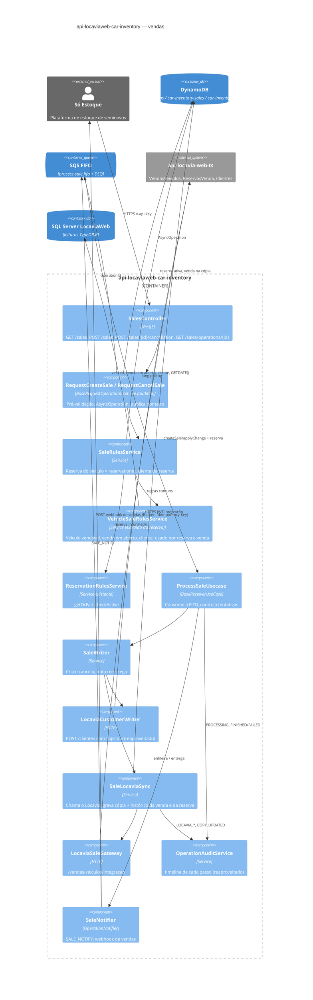
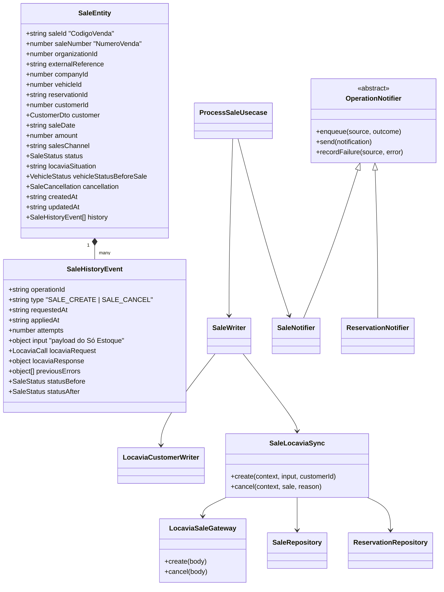
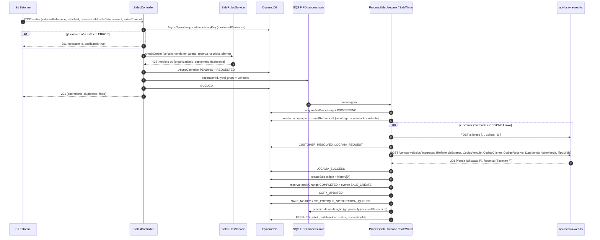
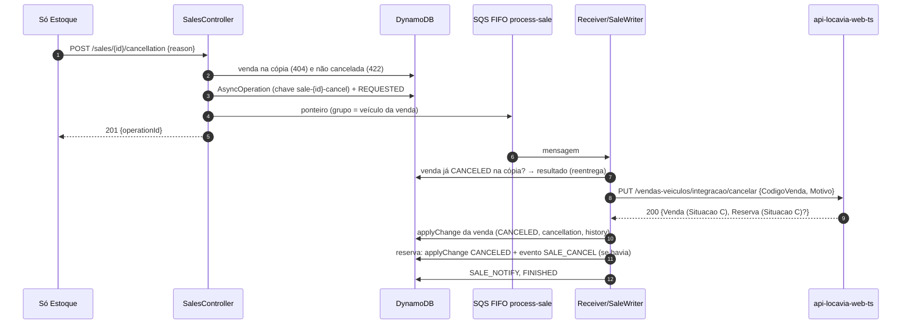

> Reaproveita o fluxo assíncrono das reservas (`01-reservations`), que segue o padrão da `api-locaviaweb-integracao-asaas`: `AsyncOperation` com `timeline` no DynamoDB, ponteiro na SQS FIFO, receiver, cópia com histórico e webhook para a Só Estoque. A gravação final é feita no Locavia por um endpoint orquestrador novo (`/vendas-veiculos/integracao`). Fonte: `sales-implementation.md`.

# 03 — Documento de Design: Vendas do Só Estoque na integração

## 1. Considerações

#### 1.1 Premissas

- **Mesmo fluxo de 5 passos das reservas** (`reservations-assinc-instructions.md`):

  | Passo | O que acontece | Onde será implementado |
  | --- | --- | --- |
  | 1 | A Só Estoque dispara a venda ou o cancelamento | `SalesController` |
  | 2 | A integração enfileira e responde o `operationId` | `RequestCreateSaleUseCase` / `RequestCancelSaleUseCase` (`AsyncOperation` + SQS FIFO) |
  | 3 | Processamento assíncrono, com auditoria de cada passo no DynamoDB, e chamada ao Locavia | `ProcessSaleUsecase` → `SaleWriter` → `SaleLocaviaSync` |
  | 4 | O Locavia responde 2xx (aplicado) ou erro, e os dois casos são registrados | `OperationAuditService` (`timeline`) e `history` da venda |
  | 5 | Mensagem à Só Estoque com o resultado no Locavia | `SaleNotifier`: operação `SALE_NOTIFY` e webhook de vendas |

- **Vendas voltam a ter escrita.** Este backlog substitui a decisão de `02-endpoints-cleanup`, que deixou vendas só com GET. A escrita removida no commit `cf6216d` (último estado completo em `52f804d`) serve de referência, mas **não é restaurada como estava**: aquela versão não tinha auditoria, notificação nem cópia, e chamava três rotas do Locavia sem atomicidade.
- **Contrato:** é o da **primeira versão do Swagger** (`origin/dev`, commit `1890b1d`), sobre a qual a Só Estoque desenvolveu. A regra é a mesma usada nas reservas:

  | Contrato | Rota | Corpo |
  | --- | --- | --- |
  | Vender | `POST /sales` | `externalReference`, `vehicleId`, `reservationId?`, `customer?`, `saleDate`, `amount`, `salesChannel`, `context?` |
  | Cancelar | `POST /sales/{id}/cancellation` | `reason`, `context?` |
  | Operação | `GET /sales/operations/{operationId}` | volta a responder (hoje é sempre 404) |
  | Lista e detalhe | `GET /sales`, `GET /sales/{id}` | sem mudança (leitura direta do Locavia) |

  As duas rotas de escrita respondem `201 {operationId, duplicated}` e aceitam o cabeçalho `x-idempotency-key`, como no contrato inicial.
- **Dono dos dados:** o Locavia (`VendasVeiculos`). O `id` da venda na API é o `CodigoVenda`. No `result` da operação ele vai como string, igual ao `reservationId`, e o `GET /sales/{id}` continua numérico como hoje.
- **DynamoDB:** é a verdade dentro da integração para as vendas feitas por ela. A tabela nova `car-inventory-sales` guarda uma cópia de cada venda, atualizada logo após cada resposta do Locavia, com o **histórico completo** das operações (mesmo modelo da reserva).
- **Códigos do Locavia não vêm da Só Estoque nem de variável de ambiente.** Empresa, empresa de recebimento, natureza de receita, tipo de mídia e motivo de cancelamento são resolvidos **pelo Locavia** no endpoint orquestrador (ver o design doc do Locavia). A integração envia só o que recebeu.
- **Cliente:** mesma regra da reserva. Se o CPF/CNPJ não existe no Locavia, a integração o cadastra (`POST /clientes`) com `Lojista = 'S'`; um cliente que já existe é reutilizado sem alteração. Se `customer` não vier, usa-se o cliente da reserva informada.
- **Venda e reserva usam as mesmas regras.** A reserva antecipa a venda, por isso as regras de "veículo vendável" já existem no fluxo de reserva, nos dois repositórios:
  - na integração, em `ReservationRulesService.checkCreate`;
  - no Locavia, em `ReservaVendaRegrasService`.

  A venda **reaproveita essas regras e não cria cópias**:
  - **Integração:** a parte comum sai do `ReservationRulesService` para um serviço compartilhado (`VehicleSaleRulesService`). O `ReservationRulesService` e o `SaleRulesService` usam esse serviço.
  - **Fluxo de venda descrito no documento da reserva:** o `SaleReservationService.check/complete` foi removido no `cf6216d`. A checagem dele volta dentro do `SaleRulesService`. A finalização passa a ser feita pelo Locavia, na mesma transação da venda, e a integração só atualiza a cópia da reserva, com o `changesOfLocavia`, que já converte `F` em `COMPLETED`, `saleId` e `completedAt`.
  - O relacionamento completo entre venda e reserva está em 2.4 ("Venda × reserva").
- **Decisões de 2026-11-10:**
  - **Gravação no Locavia:** um endpoint orquestrador novo, em vez das três chamadas existentes (`POST /vendas-veiculos`, `PUT /aprovar`, `PUT /reservas-venda/finalizar`).
  - **Motivo do cancelamento:** o código vem de `PortalSeminovosParametros.CodigoMotivoCancelamentoVenda` (coluna nova, por empresa). O texto do `reason` vai para o histórico e para as `Observacoes` da venda.
  - **Cancelar uma venda que finalizou uma reserva:** a reserva vai de `F` para `C` com o motivo "Venda cancelada" e o veículo é liberado.
  - **Formas de pagamento:** fora do contrato. A venda é aprovada sem contas a receber.
- **A validar com o produto:**
  - **Venda aprovada sem recebíveis:** o veículo vai para Vendido (`9`), mas o financeiro (contas a receber) fica a cargo da locadora no Locavia Web.
  - **Cancelamento só de vendas feitas pela integração:** o `POST /sales/{id}/cancellation` responde 404 para uma venda que não está na cópia (por exemplo, feita pela tela do Locavia Web).
  - **Webhook de vendas:** contrato provisório, definido pela integração, como foi o de reservas.
  - **`saleDate`:** é a data da venda no Locavia (`DataVenda`), sem hora.
  - **Cliente da venda × cliente da reserva:** com `reservationId`, um `customer` enviado precisa ter o mesmo CPF/CNPJ do cliente da reserva. Para vender a outra pessoa, a reserva precisa ser cancelada ou retirada antes.

#### 1.2 Restrições

- **Escritas assíncronas, sem exceção** (padrão Asaas): a requisição valida, cria a `AsyncOperation`, publica o ponteiro na FIFO (grupo = veículo) e responde `operationId`. Só o receiver chama o Locavia.
- **Locavia só por endpoints:** nenhuma escrita direta nas tabelas. As leituras de pré-validação (veículo, venda em aberto, cliente) continuam por TypeORM no banco do Locavia, como hoje.
- **TypeORM, sem SQL cru:** as leituras novas usam entidades e `QueryBuilder`.
- **Relógio:** comparações de expiração de reserva usam `GETDATE()` do Locavia (`LocaviaVehicleRepository.currentDateTime()`), nunca o relógio do pod.
- **Banco do Locavia offline nos fins de semana:** boot, Swagger e testes não dependem dele. Os e2e usam `locaviaDataFakeModule` e o fake HTTP do Locavia.
- **Ordem:** venda, reserva e cancelamento do mesmo veículo não podem ser aplicados fora de ordem. O grupo FIFO por veículo garante isso dentro da fila de vendas; entre filas, quem garante é o Locavia, que valida a reserva na mesma transação da venda.

#### 1.3 Ambiente do Sistema

- **Stack:** NestJS 12, Node 24, AWS (SQS FIFO + DLQ, DynamoDB) e EKS. Mesmo deployment.
- **Infraestrutura nova** (pequena e no mesmo padrão das reservas):
  - fila `locaviaweb-car-inventory-process-sale.fifo` + DLQ (`maxReceiveCount` 3);
  - tabela `car-inventory-sales`;
  - variáveis `SQS_QUEUE_PROCESS_SALE` e `API_SO_ESTOQUE_SALE_WEBHOOK_URL` (configuração de infraestrutura, não de negócio).
- **Por que uma fila separada e não a de reservas:** isola o volume e a DLQ de cada domínio e segue o desenho original (`52f804d`). A ordem entre venda e reserva do mesmo veículo é protegida pelo Locavia (1.2).

## 2. Arquitetura

#### 2.1 Visão Geral

**Escopo:**

- Criar a venda (inclui e aprova no Locavia e, se houver reserva, a finaliza).
- Cancelar a venda (cancela no Locavia e, se houver reserva finalizada por ela, a cancela).
- Cópia e histórico no DynamoDB (`car-inventory-sales`), e atualização da cópia da reserva envolvida.
- Auditoria (`timeline`) e notificação à Só Estoque.
- Fora do escopo: devolução de venda, formas de pagamento, alteração de venda.

**Cadeia de chamada:**

```text
Só Estoque → POST /sales → SaleRulesService (pré-validação)
  → AsyncOperation (DynamoDB) → SQS FIFO process-sale → ProcessSaleUsecase → SaleWriter
  → LocaviaCustomerWriter (POST /clientes, Lojista S) → SaleLocaviaSync
  → LocaviaSaleGateway (POST /vendas-veiculos/integracao)
  → SaleRepository.createSale (cópia + histórico) → ReservationRepository.applyChange (reserva F)
  → SaleNotifier (SALE_NOTIFY) → webhook de vendas da Só Estoque
```

| Decisão | Motivo |
| --- | --- |
| Um endpoint orquestrador no Locavia, uma chamada por operação | Inclusão, aprovação e finalização da reserva ficam numa única transação. Com três chamadas, uma queda no meio deixaria uma venda aberta sem aprovação ou uma reserva ativa com o veículo vendido. |
| Idempotência pela `ReferenciaExterna` da venda no Locavia (= `externalReference`) | A reentrega da fila devolve a mesma venda, sem consultar antes. Substitui a leitura da primeira linha de `Observacoes`, que era frágil. |
| A cópia é gravada só **depois** da resposta do Locavia | O DynamoDB nunca fica à frente do Locavia. Se a gravação da cópia falhar, a reentrega chama o Locavia de novo, e ele é idempotente. |
| A cópia da reserva é atualizada pela venda (`COMPLETED` / `CANCELED`), com evento `SALE_CREATE` / `SALE_CANCEL` no `history` dela | A resposta do orquestrador traz a reserva alterada. Sem isso, as pré-validações de reserva ficariam erradas até a próxima operação da reserva. |
| Pré-validação na requisição (422 imediato) e regra final no Locavia | O cliente recebe o erro na hora. O Locavia tem a palavra final, e uma recusa dele vira `ERROR` terminal (`LOCAVIA_WEB_REFUSED`). |
| `customer` opcional quando há `reservationId` | É o que diz o contrato inicial. O cliente vem da cópia da reserva (`customerId`). |
| Notificação como operação própria (`SALE_NOTIFY`) na fila de vendas | Igual às reservas: a falha do webhook é reprocessada sozinha, sem chamar o Locavia de novo. |
| `ReservationNotifier` vira uma base comum (`OperationNotifier`) com uma configuração por domínio | O fluxo de notificação é o mesmo. A base evita duplicar enqueue, envio, auditoria e `recordFailure`. Os nomes de evento, a fila e o webhook ficam na configuração. |
| `maxConcurrentCalls = 1` no receiver de vendas | O Locavia numera a venda com `MAX(NumeroVenda)+1` sem lock. O volume de vendas é baixo, e processar uma por vez evita número duplicado causado pela integração. |
| Sem job | Nada depende de tempo. |

#### 2.2 Diagramas de Componentes

Arquivos Draw.io:

- `drawio-diagrams/03-sales-contexto.drawio` (nível 1)
- `drawio-diagrams/03-sales-car-inventory-conteineres.drawio` (nível 2)
- `drawio-diagrams/03-sales-car-inventory-componentes.drawio` (nível 3)
- `drawio-diagrams/03-sales-fluxos.drawio` (fluxos de venda e cancelamento)



**Componentes novos:**

- **`SalesController`**: volta a ter `POST /sales` e `POST /sales/{id}/cancellation`. As leituras não mudam.
- **`RequestCreateSaleUseCase`** (`SALE_CREATE`, `audited`):
  - Chave de idempotência: `x-idempotency-key`, senão `externalReference`.
  - `externalCode` = `externalReference`; grupo FIFO = `vehicleId`.
  - `inputData` = payload + `organizationId` + `customerId` da reserva (quando o cliente vem dela).
- **`RequestCancelSaleUseCase`** (`SALE_CANCEL`, `audited`):
  - Chave `sale-{id}-cancel`; `externalCode` = `externalReference` da venda (da cópia); grupo = `vehicleId` da venda.
- **`VehicleSaleRulesService`** (`modules/vehicles` ou `common`): é extraído do `ReservationRulesService.checkCreate`, sem mudar o comportamento da reserva.
  - `checkSellable(organizationId, vehicleId)`: o veículo existe, está À venda ou em Perda total, não está alienado, não está preso a um grupo de contrato de locação e não tem venda em aberto.
  - `checkCustomer(organizationId, customer)`: o cliente não está bloqueado e, se for novo, o nome tem no máximo 100 caracteres.
  - `now()`: a hora do banco.
- **`SaleRulesService`**: pré-validação da venda. Chama o `VehicleSaleRulesService` e acrescenta só a regra da reserva (2.4). Para a reserva informada, reaproveita `ReservationRulesService.getOrFail` e `checkActive`.
- **`ProcessSaleUsecase`**: igual ao `ProcessReservationUsecase` (audita `PROCESSING`, aplica, enfileira a notificação antes do `finish`, audita `FINISHED`/`FAILED`, notifica a falha terminal). Trata `SALE_CREATE`, `SALE_CANCEL` e `SALE_NOTIFY`.
- **`SaleWriter`**: resolve o cliente e chama o `SaleLocaviaSync`. Na reentrega, encontra a venda já na cópia (pela `externalReference`) ou já cancelada e devolve o resultado existente.
- **`SaleLocaviaSync`**: audita `LOCAVIA_REQUEST`, chama o gateway, audita `LOCAVIA_SUCCESS`/`LOCAVIA_ERROR` e grava:
  - a cópia da venda (`createSale` ou `applyChange`), com `history += evento`;
  - se a resposta trouxer a reserva, converte essa reserva com o `changesOfLocavia` das reservas e chama `ReservationRepository.applyChange` com o evento `SALE_CREATE` ou `SALE_CANCEL`;
  - `COPY_UPDATED`.
- **`LocaviaSaleGateway`** (`modules/locavia-web`): `create` → `POST vendas-veiculos/integracao`, `cancel` → `PUT vendas-veiculos/integracao/cancelar`. Usa `LocaviaWebHttpService.exchange` e devolve requisição, status e resposta para o histórico.
- **`SaleRepository`** (`data/dynamo/sale`): `createSale` (idempotente), `applyChange` (um `UpdateItem` com os campos + `list_append` no `history`), `findById`, `findByExternalReference`, `findByVehicle`.
- **`OperationNotifier`** (base) com `ReservationNotifier` e `SaleNotifier` como configurações. Eventos `sale.create` e `sale.cancel`.
- **`SoEstoqueHttpService.notifySale`**: mesma `deliver` genérica, com `API_SO_ESTOQUE_SALE_WEBHOOK_URL`.

**Componentes reaproveitados sem mudança de comportamento:** `BaseRequestOperationUseCase`, `BaseReceiverUseCase`, `BaseOperationStatusUseCase`, `OperationAuditService`, `LocaviaWebHttpService`, `LocaviaCustomerWriter` (passa a ser exportado num módulo comum de clientes, usado por reservas e vendas), `ReservationRepository.applyChange` e `LocaviaSaleRepository` (leituras).

**Passos da auditoria (`timeline`):** os mesmos das reservas (`REQUESTED`, `QUEUED`, `PROCESSING`, `CUSTOMER_RESOLVED`, `LOCAVIA_REQUEST`, `LOCAVIA_SUCCESS`, `LOCAVIA_ERROR`, `COPY_UPDATED`, `SO_ESTOQUE_NOTIFICATION_QUEUED`, `FINISHED`, `FAILED`, `SO_ESTOQUE_NOTIFIED`, `SO_ESTOQUE_NOTIFICATION_ERROR`). Não há passo novo. Em `COPY_UPDATED`, o `detail` traz `saleId`, `status`, `locaviaSituation` e, quando houver, `reservationId` e `reservationStatus`.

#### 2.3 Diagramas de Classes



`SaleStatus` mantém `OPEN` (`A`), `CONCLUDED` (`P`) e `CANCELED` (`C`). Uma venda feita pela integração já sai aprovada (`CONCLUDED`).

#### 2.4 Diagramas de Sequência

**Pré-validação (`SaleRulesService`), 422 imediato.** A coluna "Origem" mostra o que é reaproveitado da reserva.

| Operação | Regra | Erro | Origem |
| --- | --- | --- | --- |
| Vender | Veículo existe na organização | 404 `VEHICLE_NOT_FOUND` | `VehicleSaleRulesService` (da reserva) |
| Vender | Status À venda (8) ou Perda total (13) | 422 `VEHICLE_NOT_SELLABLE` | idem |
| Vender | Não alienado | 422 `VEHICLE_ALIENATED` | idem |
| Vender | Não preso a grupo de contrato de locação | 422 `VEHICLE_RENTAL_RESERVED` | idem |
| Vender | Sem venda em aberto do veículo | 422 `SALE_VEHICLE_HAS_OPEN_SALE` | idem |
| Vender | Cliente existente não bloqueado; nome de cliente novo ≤ 100 | 422 `SALE_CUSTOMER_BLOCKED` / `SALE_CUSTOMER_NAME_TOO_LONG` | idem |
| Vender | Reserva ativa do veículo na cópia (`findActiveByVehicle` com a hora do banco): se existe, `reservationId` é obrigatório e igual a ela | 422 `VEHICLE_RESERVED` | nova (a reserva usa a mesma consulta para dar `VEHICLE_ALREADY_RESERVED`) |
| Vender | `reservationId` informado: existe, é da organização, está ativa e não vencida | 404 `RESERVATION_NOT_FOUND` / 422 `RESERVATION_NOT_ACTIVE` | `ReservationRulesService.getOrFail` / `checkActive` |
| Vender | `reservationId` informado é do mesmo veículo | 422 `RESERVATION_VEHICLE_MISMATCH` | nova |
| Vender | `customer` ausente só com `reservationId`; enviado junto com a reserva, mesmo CPF/CNPJ da reserva | 422 `SALE_CUSTOMER_REQUIRED` / `SALE_CUSTOMER_DIFFERS_FROM_RESERVATION` | nova |
| Cancelar | Venda existe na cópia e é da organização | 404 `SALE_NOT_FOUND` | nova |
| Cancelar | Venda não está cancelada | 422 `SALE_ALREADY_CANCELED` | nova |

**Venda × reserva (o que cada lado faz com o outro):**

| Situação | Reserva | Venda | Quem garante |
| --- | --- | --- | --- |
| Veículo sem reserva | — | Permitida sem `reservationId` | Integração e Locavia |
| Reserva `A` válida, venda com o mesmo `reservationId` | `A → F` (`CodigoVenda`), cópia `COMPLETED` + evento `SALE_CREATE` | Permitida | Locavia (`FinalizarReservasVenda` na transação) |
| Reserva `A` válida, venda sem `reservationId` ou com outro | Não muda | 422 na integração, 409 no Locavia | Integração e Locavia |
| Reserva `A` vencida, venda sem `reservationId` | Gravada como `E` (`validarVeiculoSemReserva`) | Permitida | Locavia |
| Reserva `A` vencida, venda com o `reservationId` dela | Não muda | 422 `RESERVATION_NOT_ACTIVE` | Integração e Locavia |
| Reserva `C`, `R` ou `E` | — | Não bloqueia | Integração e Locavia |
| Venda aprovada (veículo `9`) e nova reserva | 422 (veículo não vendável / venda em aberto) | — | Regras da reserva (já existem) |
| Cancelar ou retirar uma reserva `F` | 422 (`validarReservaAtiva`) | — | Regras da reserva (já existem) |
| Cancelar a venda | `F → C` ("Venda cancelada."), cópia `CANCELED` + evento `SALE_CANCEL` | `P → C`, veículo `9 → 8/13` | Locavia (orquestrador) |
| Reserva cancelada enquanto a venda está na fila | Já `C` | `ERROR` terminal (422 do Locavia) e notificação de falha | Locavia (transação) |

Natureza de receita configurada, recebíveis quitados e nota fiscal ativa são regras do Locavia. Quando ele recusa, a operação termina em `ERROR` com o texto dele.

**Vender (com reserva):**



**Cancelar (`POST /sales/{id}/cancellation`):**



**Fluxo completo (passos 1 a 5) e tratamento de erros:** é o mesmo diagrama das reservas (`01-reservations-design-doc-api-locaviaweb-car-inventory.md`, 2.4), trocando a fila por `process-sale` e a operação de notificação por `SALE_NOTIFY`.

| Situação | Resultado |
| --- | --- |
| Pré-validação | 404, 422 ou 400 (DTO) na hora, sem nada na fila |
| 4xx do Locavia (inclui 409 de reserva de outra pessoa) | `LocaviaWebException` 422: `ERROR` terminal, DLQ, texto do Locavia em `lastError.cause`, notificação de falha |
| 5xx ou timeout | Reprocessa com backoff exponencial; o histórico guarda os erros em `previousErrors` |
| Falha ao gravar a cópia depois do 2xx | Reentrega: o Locavia devolve a mesma venda (idempotente) e a cópia é gravada |

**Webhook de vendas para a Só Estoque (contrato provisório):**

```json
{
  "event": "sale.create | sale.cancel",
  "success": true,
  "operationId": "id respondido no passo 2",
  "externalReference": "SE-SAL-000310",
  "saleId": "8812",
  "occurredAt": "2026-11-10T14:00:05.000Z",
  "sale": { "id": 8812, "status": "CONCLUDED", "...": "igual a GET /sales/{id}" },
  "reservation": { "id": "1024", "status": "COMPLETED" },
  "error": { "code": "LOCAVIA_WEB_REFUSED", "message": "texto do Locavia (somente quando success = false)" }
}
```

#### 2.5 Diagramas de Implantação

Mesmo deployment no EKS. Recursos AWS novos: a fila `process-sale.fifo` (com DLQ) e a tabela `car-inventory-sales`.

**Configuração nova:**

- `SQS_QUEUE_PROCESS_SALE` = `$(Sqs_Process_Sale_Url)` em `manifests/secrets.yml`, `.env.example` e `docker-compose.yml`.
- `API_SO_ESTOQUE_SALE_WEBHOOK_URL` = `$(Api_So_Estoque_Sale_Webhook_Url)`. O token é o mesmo `API_SO_ESTOQUE_ACCESS_TOKEN`. Sem a variável, a notificação fica em erro reprocessável (`SO_ESTOQUE_NOT_CONFIGURED`) até a DLQ, e a venda no Locavia não é afetada.
- `DYNAMODB_TABLE_SALE` (padrão `car-inventory-sales`), com chave `saleId` e os índices `vehicleId-index`, `organizationId-index` e `externalReference-index`.
- `scripts/localstack/init-aws.sh` cria a fila e a tabela.

| Risco | Severidade | Mitigação |
| --- | --- | --- |
| Contrato do webhook de vendas ainda provisório | Alta | Validar payload e URL com a Só Estoque antes do go-live. A notificação é isolada em `SaleNotifier`. |
| Venda sem recebíveis no Locavia | Alta | Validar com o produto. Se for necessário, `paymentMethods` entra como campo aditivo (já existiu em `52f804d`). |
| Venda alterada ou cancelada pela tela do Locavia Web não aparece na cópia | Média | Hoje a cópia é o registro do que a integração fez. Se for preciso refletir mudanças da tela, publicar um evento no Locavia e consumir na integração. |
| Nova coluna no Locavia sem valor (`CodigoMotivoCancelamentoVenda` ou natureza de receita) | Média | O Locavia responde 422 com mensagem clara, a operação fica `ERROR` e a Só Estoque recebe a falha. Configurar `PortalSeminovosParametros` antes do go-live. |
| `NumeroVenda` duplicado por concorrência com a tela | Baixa | Receiver de vendas com uma mensagem por vez. A concorrência com a tela já existe hoje e não é agravada. |
| Lista de rotas fixada no `test/app.e2e-spec.ts` | Baixa | Atualizar a lista e trocar o teste que espera 404 em `POST /sales`. |

#### 2.6 Outros Diagramas

**Item da venda no DynamoDB (`car-inventory-sales`, depois de vender e cancelar):**

```json
{
  "saleId": "8812",
  "saleNumber": 1503,
  "organizationId": 1,
  "externalReference": "SE-SAL-000310",
  "companyId": 12,
  "vehicleId": 4522,
  "reservationId": "1024",
  "customerId": 9120,
  "saleDate": "2026-11-10",
  "amount": 73500,
  "salesChannel": "Só Estoque",
  "status": "CANCELED",
  "locaviaSituation": "C",
  "vehicleStatusBeforeSale": "FOR_SALE",
  "cancellation": { "reason": "Financiamento negado", "canceledAt": "2026-11-12T09:00:00.000Z" },
  "history": [
    { "operationId": "…", "type": "SALE_CREATE", "attempts": 1, "input": { "...": "payload" },
      "locaviaRequest": { "method": "POST", "route": "vendas-veiculos/integracao", "body": { "...": "" } },
      "locaviaResponse": { "Venda": { "CodigoVenda": 8812, "Situacao": "P" }, "Reserva": { "CodigoReserva": 1024, "Situacao": "F" } },
      "statusAfter": "CONCLUDED" },
    { "operationId": "…", "type": "SALE_CANCEL", "attempts": 1,
      "locaviaRequest": { "method": "PUT", "route": "vendas-veiculos/integracao/cancelar" },
      "statusBefore": "CONCLUDED", "statusAfter": "CANCELED" }
  ]
}
```

**Plano de testes:**

| Tipo | Arquivo | Cobertura |
| --- | --- | --- |
| Unitário | `sale-rules.service.spec.ts` | Cada linha da tabela de pré-validação e da tabela venda × reserva |
| Unitário | `vehicle-sale-rules.service.spec.ts`, `reservation-rules.service.spec.ts` | Regras compartilhadas; a reserva continua com os mesmos erros depois da extração |
| Unitário | `request-create-sale.usecase.spec.ts`, `request-cancel-sale.usecase.spec.ts` | Idempotência, `duplicated`, grupo FIFO, `REQUESTED`/`QUEUED` |
| Unitário | `process-sale.usecase.spec.ts` | Passos 3 a 5, erro terminal × reprocessável, notificação antes do `finish` |
| Unitário | `sale-writer.service.spec.ts`, `sale-locavia-sync.service.spec.ts` | Reentrega, cliente novo × existente × da reserva, cópia da venda e da reserva |
| Unitário | `sale-notifier.service.spec.ts`, `operation-notifier.spec.ts` | Payload de sucesso e falha, `Idempotency-Key`, `ReservationNotifier` sem regressão |
| Unitário | `sale.repository.spec.ts` | `createSale` idempotente, `applyChange` com `list_append` |
| Integração (e2e) | `test/sales.e2e-spec.ts` | Venda com e sem reserva, cancelamento com reserva voltando a `CANCELED`, recusa do Locavia, 5 passos com o fake da Só Estoque |
| Integração (e2e) | `test/app.e2e-spec.ts` | Lista de rotas com `POST /sales` e `POST /sales/{id}/cancellation` |
| Fake | `test/support/locavia-web.fake-server.ts` | `POST /vendas-veiculos/integracao` e `PUT /vendas-veiculos/integracao/cancelar`, com as regras do Locavia |

## 3. Design de Interface do Usuário

Não se aplica, porque a integração é uma API. O fluxo de uso está nos diagramas de sequência (2.4) e vai para a collection Postman `postman/03-sales-car-inventory.postman_collection.json`:

1. Token
2. Reservar (opcional)
3. Vender
4. Consultar a operação
5. Ler a venda
6. Cancelar
7. Consultar de novo

## 4. Apêndices e Referências

#### 4.1 Definições e Abreviações

| Termo | Definição |
| --- | --- |
| Cópia da venda | Item `car-inventory-sales` com o último estado respondido pelo Locavia e o histórico. |
| Orquestrador | Endpoint `/vendas-veiculos/integracao` do Locavia, que inclui, aprova e finaliza a reserva numa transação. |
| `AsyncOperation` | Registro de controle de cada escrita (status, tentativas, erros, resultado, `timeline`). |
| Situação da venda | `A` aberta, `P` aprovada, `C` cancelada (`VendasVeiculos.Situacao`). |
| Hora do banco | `GETDATE()` do SQL Server do Locavia, exposta em formato UTC sem conversão. |

#### 4.2 Referências

**Código atual** (`api-locaviaweb-car-inventory`):

- `src/modules/sales/**` (leitura)
- `src/modules/reservations/**`, incluindo `services/reservation-notifier.service.ts` e `services/locavia-customer-writer.service.ts`
- `src/modules/receiver/usecases/process-reservation.usecase.ts`
- `src/common/usecases/base-{request-operation,receiver,operation-status}.usecase.ts`
- `src/data/dynamo/async-operation/**`

**Escrita removida (referência):** `git show 52f804d:src/modules/sales/...` e `git show 52f804d:test/support/locavia-web.fake-server.ts`.

**Contrato inicial:** `origin/dev` (commit `1890b1d`), `src/modules/sales/dto/*`.

**Locavia:** `03-sales-design-doc-api-locavia-web-ts.md`.

**Instruções:** `sales-implementation.md`; fluxo assíncrono em `01-reservations/reservations-assinc-instructions.md`.
